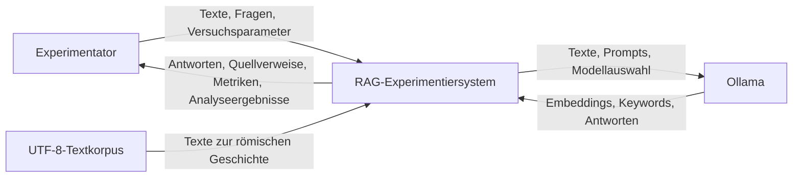

# 3 Kontextabgrenzung (draft)

## 3.1 Fachlicher Kontext

Die Systemgrenze umfasst die projektspezifische Verarbeitung: Import- und Analysewerkzeuge, RAG-API, Vector-API, Vektorhaltung und den optionalen Reranker. Ollama wird als externer Modelldienst angebunden. Der Experimentator bedient das System lokal über Werkzeuge und HTTP-Clients; ein eigenes Webfrontend gehört derzeit nicht dazu.

| Kommunikationspartner / Quelle | Eingang in das System | Ausgang / Zweck |
|---|---|---|
| Experimentator, einziger Stakeholder | Fragen, Importaufträge, Modell- und Set-Auswahl, Such- und Experimentparameter | Antworten mit Quell-Chunk-IDs, Treffer, Metriken und Protokolle zur Bewertung der Experimente |
| Textkorpus | UTF-8-Dateien mit historischen Texten | Grundlage für Chunking, Anreicherung, Embeddings und Retrieval |
| Ollama | Modellantworten und Embeddingvektoren | Erhält Texte beziehungsweise Prompts und Modellkennungen für Embedding, Keyword-Anreicherung und Generierung |

Korpus und Modelldienst sind technische beziehungsweise fachliche Nachbarn und keine weiteren Stakeholder. Die Bewertung der Versuchsergebnisse liegt beim Experimentator. Eine automatische fachliche Gesamtbewertung der Strategien wird hier nicht vorausgesetzt.

## 3.2 Technischer Kontext

| Verbindung | Schnittstelle / Übertragung | Einordnung |
|---|---|---|
| Experimentator → lokale Werkzeuge | Python-Aufrufe im Projektstamm; Dateizugriff auf UTF-8-Texte | Import, direkte Abfragen und Analyse auf dem Host |
| HTTP-Client → RAG-API | HTTP/JSON, `POST /process`, Containerport 5600 | Frage, Set-Filter und Suchparameter; Antwort mit `response`, `chunks` und `metrics` |
| Lokale Werkzeuge → Vector-API | HTTP/JSON, Port 5500 | Speicherung, Suche und Inspektion von Chunks und Embeddings |
| Lokale Werkzeuge → Reranker | HTTP/JSON, `POST /rerank`, Port 5000 | Optionales Bewerten und Sortieren von Frage-Dokument-Paaren; kein Bestandteil des aktuellen RAG-API-Ablaufs |
| System → Ollama | HTTP/JSON, üblicherweise Port 11434; unter anderem `/api/embeddings` und `/api/generate` | Host- und Containerzugriffe können unterschiedliche Adressen benötigen. |
| Build und Modellbereitstellung → externe Quellen | Paket-, Quellcode-, Basisimage- und Modelldownloads | Bereitstellung der Abhängigkeiten; keine weiteren menschlichen Stakeholder |

PostgreSQL/pgvector liegt innerhalb der Systemgrenze und wird von der Vector-API angesprochen. Seine Daten verbleiben in einem persistenten Volume. Interne Komponenten und Verbindungen beschreibt die [Bausteinsicht](5-bausteinsicht.md).

Im Referenzbetrieb liegen Host, Podman-Machine und Linux-Container in unterschiedlichen Netzwerkbereichen. Ein `localhost` im Container bezeichnet nicht den Windows-Host. Die Ollama-Adresse wird explizit konfiguriert oder durch den vorhandenen Resolver ermittelt. Netzwerkverhalten und Grenzen stehen in der [Laufzeitsicht](6-laufzeitsicht.md), Container, Ports und Speicher in der [Verteilungssicht](7-verteilungssicht.md).

Die Portangaben beschreiben die üblichen Dienstports. Hostmappings können abweichen; der isolierte Teststack verwendet dynamische API-Hostports. Plattformabhängige Pfade, Netzwerkauflösung und optionale GPU-Anbindung sind bei einem Plattformwechsel gesondert zu prüfen.
