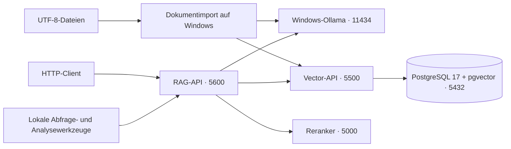

<!--

purpose: "Statische Zerlegung des Systems in Bausteine mit Verantwortlichkeiten, Schnittstellen und Abhängigkeiten."
agent_instructions:
  - "Das Gesamtsystem auf der obersten Ebene als Whitebox zeigen und seine Bausteine als Blackboxes mit Zweck, Verantwortung und relevanten Schnittstellen erklären. Nur wichtige Bausteine auf weiteren Ebenen verfeinern und auf die Implementierung verweisen."
  - "Interne statische Beziehungen hier pflegen und für externe Systemgrenzen (3), zeitliche Interaktionen (6) und Infrastrukturzuordnung (7) auf die jeweiligen Sichten verweisen."
  - "In diesem Kapitel nur den aktuellen Stand und ausdrücklich als offen gekennzeichnete Ziele beschreiben."
  - "Weiterhin gültige Änderungen direkt in den fachlich passenden Abschnitt einarbeiten und überholte Aussagen ersetzen."
  - "Keine datierten Nachträge, Änderungshistorie, Prüfergebnisse oder Ausrollstände in dieses Kapitel aufnehmen. Diese ausschließlich in ../changelog.md dokumentieren."

-->

# 5 Bausteinsicht nach arc42 – Römer-RAG

Die [Lösungsstrategie](4-loesungsstrategie.md#verantwortlichkeiten-und-abhängigkeiten) erläutert die Prinzipien, nach denen Zuständigkeiten und Abhängigkeiten der Bausteine festgelegt sind.

Die [Laufzeitsicht](6-laufzeitsicht.md) beschreibt Aufrufreihenfolge und Netzwerkverhalten; das [README](../README.md) enthält Setup und Startbefehle.

## 5.1 Gesamtsystem als Blackbox

Das System erschließt Texte zur römischen Geschichte und beantwortet Fragen anhand abgerufener Textabschnitte. Es dient der experimentellen Bewertung von Import-, Retrieval- und Modellstrategien. Ein eigenes Webfrontend ist nicht enthalten.

| Nachbar / Rolle | Eingabe | Ausgabe / Nutzung |
|---|---|---|
| Fragesteller über HTTP | Frage, Set, Metrik, Trefferanzahl und optionale Reranking-Parameter | Antwort, Treffer und Laufzeitmetriken |
| Importierender | UTF-8-Dateien, optional Start-Chunk | gespeicherte Chunks und Embeddings, Zwischenartefakte und Startnummer bei Fehlern |
| Experimentierender | Fragen, Texte und Trefferlisten | Retrievaldiagnose, Modell- und Reranking-Ergebnisse |
| Modell- und Paketquellen | Downloads beim Build bzw. Modellbereitstellen | Python-Pakete, pgvector-Quellcode und Modellgewichte |

Die zentrale Außenschnittstelle ist `POST /process` der RAG-API auf Containerport 5600. Der Dokumentimport greift direkt auf Ollama und Vector-API zu. Ollama läuft im beschriebenen Windows-Betrieb als Hintergrund-App außerhalb der Linux-Container.

## 5.2 Ebene 1 – Whitebox

| Baustein | Verantwortung | Maßgebliche Implementierung |
|---|---|---|
| Dokumentimport | Chunking, optionale Keywords, normalisierte Embeddings und Speicherung | [pipeline.py](../Ingest/pipeline.py), [import3.py](../Ingest/import3.py), [chunking.py](../Ingest/utils/chunking.py), [keywords.py](../Ingest/utils/keywords.py), [gateway.py](../Ingest/utils/gateway.py) |
| RAG-API | Embedding, Retrieval, optionales Reranking, Kontext und Generierung orchestrieren | [app.py](../rag/app.py), [ollama_endpoint.py](../rag/ollama_endpoint.py), [Dockerfile](../rag/Dockerfile) |
| Vector-API | CRUD und Ähnlichkeitssuche über PostgreSQL | [app.py](../Vector/app.py), [Dockerfile.api](../Vector/Dockerfile.api) |
| Vektorspeicher | Chunks, Varianten und Vektoren persistent speichern | [init.sql](../Vector/init.sql), [Dockerfile](../Vector/Dockerfile) |
| Ollama | Embedding-, Antwort- und Keyword-Modelle ausführen | Windows-Hintergrund-App; Bereitstellung gemäß README |
| Reranker | Frage-Dokument-Paare bewerten und sortieren | [app.py](../reranker/app.py), [Dockerfile](../reranker/Dockerfile) |
| Lokale Werkzeuge | Abfragen und Analysen über die RAG-API | [interact.py](../interact.py), [analyze.py](../analyze.py) |

Die Endpunkte validieren und dekodieren ihre Eingaben vor Datenbank- oder Modellzugriffen. Die Vector-API und der RAG-Retrievalschritt verwenden gemeinsame Prüfungen für den [Vector-Suchvertrag](../rag_common/vector_contract.py). Die Ergebnisvalidierung und die Zugriffe auf Provider, Datenbank und Modelle melden Fehler über Python-Ausnahmen ihrer jeweiligen Schicht. Die Flask-Apps ordnen ihnen an der HTTP-Grenze Problemtypen zu. [rag_common/http_errors.py](../rag_common/http_errors.py) erzeugt daraus RFC-9457-Problemantworten mit stabiler Typ-URI und Request-ID. Die [Fehlerverträge](8-3-error-handling.md) beschreiben die Regeln im Detail.

## 5.3 Ebene 2 – zentrale Bausteine

### 5.3.1 Dokumentimport

`Ingest.pipeline` liest die Versuchskonfiguration und verwendet rekursives Chunking, optionale Keyword-Anreicherung und normalisierbare Embeddings. Versionierte Zwischenartefakte erlauben die Wiederverwendung bereits erzeugter Chunks oder Anreicherungen. Chunks haben IDs aus Dateistamm und Nummer ab 1. Die Pipeline schreibt jeden Chunk über `POST /vectors` und bereinigt nach erfolgreichem Abschluss überzählige Chunks mit `DELETE /chunks`. Bei Abbruch bleiben bestätigte Chunks abrufbar und die Pipeline gibt den Wert für `--start` aus. Dienstadressen werden über `OLLAMA_HOST_URL` und `IMPORT_VECTOR_URL` konfiguriert. Aufrufe und Artefakte beschreibt das [Importkonzept](8-4-importkonzept.md).

Der separate Einstieg `import3.py` bleibt bis zum persönlichen Test der Pipeline durch den Projektverantwortlichen als Fallback verfügbar. Er nutzt LangChains `RecursiveCharacterTextSplitter` mit 1000 Zeichen und 150 Zeichen Overlap sowie das Keyword-Gateway mit `gemma3:4b`. Er speichert normalisierte Embeddings und den angereicherten Text einzeln über `POST /vectors`, unterstützt `--start` und protokolliert Fehler pro Chunk. Er verwendet im Skript konfigurierte Dienstadressen und HTTP-Zeitlimits. Import3, CLI und RAG beziehen gemeinsame Modell- und Set-Defaults aus [embedding_config.py](../rag/embedding_config.py).

### 5.3.2 RAG-API

| Teil | Verantwortung / Konfiguration |
|---|---|
| HTTP-Einstieg | `POST /process` liest `query`, `embedding_set_id`, `metric`, `num_results` und optionale Modell- und Reranking-Parameter. Standard sind Set `snowflake-arctic-embed2-v2`, Metrik `euclidean` und fünf Treffer. |
| Ollama-Resolver | `OLLAMA_BASE_URL` hat Vorrang. Sonst Prüfung des Podman-Hostnamens und unter WSL der sichtbaren IPv4-Default-Gateways über `/api/tags`. Erfolgreiche Auswahl wird pro Prozess gespeichert. |
| Embeddingadapter | `/api/embeddings`, Modell `snowflake-arctic-embed2`, Normalisierung des Fragevektors. |
| Retrievaladapter | `VECTOR_API_URL`, Standard `http://host.containers.internal:5500/search`. Im gemeinsamen Pod explizit `http://127.0.0.1:5500/search` setzen. |
| Reranking | Ruft den separaten Reranker bei vorhandenen Treffern und `top_k > 0` auf. Standardmäßig ist Reranking für `/process` deaktiviert. |
| Kontextbildung | Validiert `chunk_id` und `chunktext` und verknüpft die nicht leeren Texte der ausgewählten Treffer. |
| Generierungsadapter | `/api/generate`, Modell `gemma4:e4b`, ohne Streaming; liefert Antwort und Laufzeit-/Tokenmetriken. |

Die Antwort enthält `response`, `chunks`, `metrics` sowie getrennte `retrieved_results` und `selected_results`. Leerer Kontext führt zu HTTP 200 mit `status: no_context`, leeren `chunks` und `metrics: null`. Ungültige Retrievalantworten ergeben HTTP 502. Die Serverzeiten `embedding_duration`, `retrieval_duration` und `pipeline_duration` stehen in `timings`, auch bei `no_context`. Generierungsmetriken verwenden `generation_duration` mit `total_duration` als Alias. Ungültige optionale Metriken werden als `null` ausgegeben. Der Prompt begrenzt die Antwort auf den Kontext. Ein erfolgreicher API-Aufruf garantiert keine Faktentreue.

Die Evaluationsendpunkte `POST /evaluate/retrieve`, `POST /evaluate/rerank` und `POST /evaluate/generate` verwenden dieselben Providerfunktionen. `next_request` verbindet die Schritte über serialisierbare Eingaben. Trefferidentität und Trefferfelder bleiben erhalten. `/evaluate/retrieve` fordert Treffervektoren nur für `include_distances: true` an und liefert daraus berechnete Diagnosen. Der Fragevektor ist mit `include_query_vector: true` abrufbar. Trefferausgabe und Folgeaufrufe aus Retrieve enthalten keine Vektoren. Die Endpunkte speichern weder Vektoren noch Sitzungszustand.

`interact.py` validiert CLI-Argumente, ruft `/process` auf und übernimmt Ausgabe und lokalen Export. `analyze.py` ruft `/evaluate/retrieve` mit Distanzdiagnostik auf und übergibt `next_request` an `/evaluate/generate`. RAG berechnet Cosinus-Ähnlichkeit und euklidischen Abstand für die Treffer und optional für den vom Analysewerkzeug übergebenen Gold-Chunk. Die Transportadapter begrenzen Zeitlimits und Wiederholungen für sicher wiederholbare Aufrufe. Generierung und Writes werden nicht automatisch wiederholt. Die [Laufzeitsicht](6-laufzeitsicht.md) beschreibt Aufrufreihenfolge, Netzwerk und Retry-Verhalten.

### 5.3.3 Vector-API und Datenhaltung

Die Vector-API initialisiert den `ThreadedConnectionPool` erst nach der Eingabevalidierung. Er umfasst eine bis zehn Verbindungen. Fehlgeschlagene Initialisierungen werden bei späteren Anfragen erneut versucht. Gleichzeitige Anfragen warten nicht auf den Initialisierungslock. Verbindungs-, Statement- und Lock-Wartezeit sind jeweils auf drei Sekunden begrenzt. Der Transaktionskontext führt Commit oder Rollback aus und verwirft defekte Verbindungen. Einstellungen sind `POSTGRES_DB`, `DB_HOST`, `DB_PORT`, `DB_USER` und `DB_PASSWORD`.

`GET /health/live` prüft nur den Prozess. `GET /health/ready` prüft Datenbankzugriff und Schema. Fehlende Bereitschaft und Poolerschöpfung ergeben HTTP 503. Nach einem Datenbankwiederanlauf kann sich die API ohne Neustart erholen.

| Methode / Pfad | Aufgabe |
|---|---|
| `GET /chunks?embedding_set_id=...` | Zeilen zählen; Antwortfeld `chunks`, Filter optional |
| `GET /chunks/<chunk_id>?embedding_set_id=...` | Einzelnen Chunk aus dem angegebenen Set lesen. `include_vector=true` liefert den gespeicherten Vektor mit. |
| `POST /vectors` | Datensatz anhand von `chunk_id` und `embedding_set_id` per Upsert speichern und interne ID bei Updates erhalten. HTTP 201 |
| `GET /find?query=...&embedding_set_id=...` | Chunk-IDs im angegebenen Set anhand eines case-insensitiven Musters in `chunktext` (`ILIKE`) finden |
| `DELETE /chunks` | Kanonische Chunknummern in einem Dokument und Set im inklusiven Bereich `from` bis `to` löschen |
| `POST /search` | Suche mit `vector`, `embedding_set_id`, optional `metric`, `num_results` und boolesches `include_vector`; `euclidean` (`<->`) und `cosine` (`<=>`) werden unterstützt, ungültige Metriken liefern HTTP 400 |

Der JSON-Body für `DELETE /chunks` enthält `document_id` (Dateistamm), `embedding_set_id` und die positive Ganzzahl `from`. `to` ist optional und muss als Ganzzahl mindestens so groß wie `from` sein. Gleiche Grenzen löschen einen einzelnen Chunk. Ohne `to` reicht der Bereich bis zum Ende. IDs im Format `<Dateistamm>-<Nummer ab 1>` werden exakt dem Dokument zugeordnet. HTTP 200 gibt mit `{"deleted": 2}` die Anzahl gelöschter Zeilen an. Ungültige Angaben ergeben HTTP 400.

Die Tabelle `vectors` enthält `id SERIAL PRIMARY KEY`, `chunk_id TEXT NOT NULL`, `embedding_set_id TEXT NOT NULL`, `vector VECTOR(1024)` und `chunktext TEXT NOT NULL`. Ein Check-Constraint verlangt mindestens ein Zeichen außerhalb von Leerzeichen, LF und CR. Die Vector-API prüft dieselbe Regel vor dem Datenbankzugriff. `embedding_set_id` ist die Variantenkennung, kein numerischer Vektor. `UNIQUE(chunk_id, embedding_set_id)` trennt Importvarianten. Einzelwrites verwenden Upserts und sind nach der jeweiligen Transaktion abrufbar. Die abschließende Bereinigung verwendet eine eigene Transaktion. Ein HNSW-Index mit `vector_l2_ops` unterstützt euklidische Suche. Die Vector-API akzeptiert Vektoren als JSON-Zahlenlisten mit 1024 endlichen Zahlen. Die Vector-API verwendet `embedding_set_id` als Set-Kennung in Anfragen und Antworten. Angeforderte Vektoren werden wie der RAG-Fragevektor als JSON-Zahlenlisten ausgegeben.

### 5.3.4 Ollama und Reranker

Ollama benötigt `snowflake-arctic-embed2` für Embeddings und `gemma4:e4b` für RAG-Antworten. `import3.py` benötigt zusätzlich `gemma3:4b`. Die Modelle werden auf dem Windows-Host bereitgestellt; sie liegen nicht im RAG-Image oder im PostgreSQL-Volume.

Das Reranker-Image installiert Flask, sentence-transformers und torch und laedt beim Build `cross-encoder/ms-marco-MiniLM-L6-v2` vor. `POST /rerank` akzeptiert optional `model`; ohne Angabe gilt `RERANK_MODEL`. Ein aktiver CrossEncoder wird bei gleicher Auswahl wiederverwendet und bei Modellwechsel ersetzt. Laden und Inferenz sind gemeinsam synchronisiert. Neue Gewichte werden bei Bedarf geladen; Modelle mit erforderlichem Remote-Code werden nicht unterstuetzt (`trust_remote_code=False`). Ladefehler liefern HTTP 503 ohne Fallback. Antworten enthalten das verwendete `model` und `ranked_documents` mit `original_index`, `score` und `text`, absteigend sortiert. Leere Dokumentlisten laden kein Modell. `/health` nennt das aktive Modell und laedt beim ersten Aufruf das Defaultmodell.

## 5.4 Zuordnung zum Podman-Betrieb

Die [Verteilungssicht](7-verteilungssicht.md) zeigt die Infrastruktur mit Windows, WSL, Pods und Containern sowie die konkreten Ports, Volumes und Betriebsvarianten.

Die Dockerfiles installieren Pakete und kopieren Anwendungscode beim Image-Build. [build_image.py](../scripts/build_image.py) baut API-Images aus temporären Kontexten mit explizit ausgewählten Quelldateien und `rag_common`. Codeänderungen werden über ein neues Image und einen neu erstellten Container übernommen.

Im README-Neuaufbau teilen PostgreSQL, Vector-API und RAG-API den Pod `vectorpod`. PostgreSQL speichert Daten im Named Volume `pgvector-data`; `init.sql` wird nur bei Initialisierung eines leeren Datenverzeichnisses ausgeführt. Ein Image-Neubau migriert keine vorhandene Datenbank. Der optionale Reranker läuft separat auf Port 5000. Ollama läuft als Windows-Hintergrund-App auf Port 11434.

Die RAG-API kann auch separat auf Port 5600 laufen und die Vector-API über deren veröffentlichten Port erreichen. Bestehende Datenbanken werden bei Schemaänderungen mit dem Backup- und Migrationsverfahren aus dem README aktualisiert.

Die Testfixture baut einen eigenen Pod mit eindeutigen Container-/Image-Namen und eigenem Volume auf. API-Hostports vergibt Podman dynamisch, PostgreSQL wird nicht am Host veröffentlicht. Die Test-RAG-API sucht innerhalb des Test-Pods. Nur Ollama wird mit dem Host geteilt. Details stehen im [Testkonzept](8-1-testkonzept.md).

## 5.5 Offene Punkte

Das [Schuldenregister](11-2-technische-schulden.md) führt aktuelle Befunde und Schweregrade. Für die Bausteinsicht sind insbesondere folgende Einschränkungen relevant:

- Paketversionen und pgvector-Quellstand sind nicht vollständig fixiert. Der HNSW-Index unterstützt euklidische Distanz.
- Die Dienste verwenden Flask-Entwicklungsserver ohne API-Authentifizierung. Für RAG und Reranker fehlt eine vergleichbare Trennung von Liveness und Readiness.
- Die Evaluationsendpunkte ermöglichen Einzelversuche. Goldvergleich und aggregierte Qualitätsmessung sind offen.
