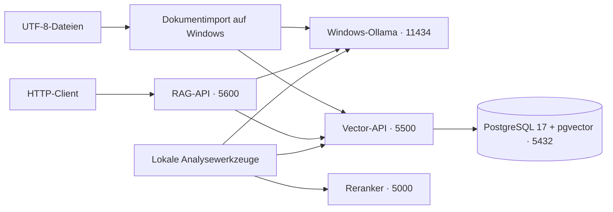

# 5 Bausteinsicht nach arc42 – Römer-RAG

Stand: 15.11.2026. Grundlage sind die aktuellen Python-Dateien, Dockerfiles, das SQL-Schema und die pytest-Fixtures. Verzeichnisse namens `k8s` sind historische Referenzen und wurden nicht zur Beschreibung des aktuellen Betriebs herangezogen. Die [Laufzeitsicht](6-laufzeitsicht.md) beschreibt Aufrufreihenfolge und Netzwerkverhalten; das [README](../README.md) enthält Setup und Startbefehle.

## 5.1 Gesamtsystem als Blackbox

Das System erschließt Texte zur römischen Geschichte und beantwortet Fragen anhand abgerufener Textabschnitte. Es dient der experimentellen Bewertung von Import-, Retrieval- und Modellstrategien. Ein eigenes Webfrontend ist nicht enthalten.

| Nachbar / Rolle | Eingabe | Ausgabe / Nutzung |
|---|---|---|
| Fragesteller über HTTP | Frage, Variantenfilter, Metrik, Trefferanzahl | Antwort, Chunk-IDs, Generierungsmetriken |
| Importierender | UTF-8-Dateien, optional Start-Chunk | gespeicherte Chunks und Embeddings, Importprotokolle |
| Experimentierender | Fragen, Texte und Trefferlisten | Retrievaldiagnose, Modell- und Reranking-Ergebnisse |
| Modell- und Paketquellen | Downloads beim Build bzw. Modellbereitstellen | Python-Pakete, pgvector-Quellcode und Modellgewichte |

Die zentrale Außenschnittstelle ist `POST /process` der RAG-API auf Containerport 5600. Lokale Import- und Analysewerkzeuge greifen auch direkt auf Ollama und Vector-API zu. Ollama läuft im beschriebenen Windows-Betrieb als Hintergrund-App außerhalb der Linux-Container.

## 5.2 Ebene 1 – Whitebox

| Baustein | Verantwortung | Maßgebliche Implementierung |
|---|---|---|
| Dokumentimport | Chunking, optionale Keywords, normalisierte Embeddings und Speicherung | [import3.py](../Ingest/import3.py), [chunking.py](../Ingest/chunking.py), [keywords.py](../Ingest/keywords.py), [gateway.py](../Ingest/gateway.py) |
| RAG-API | Embedding, Retrieval, Kontext und Antwort orchestrieren | [app.py](../rag/app.py), [ollama_endpoint.py](../rag/ollama_endpoint.py), [Dockerfile](../rag/Dockerfile) |
| Vector-API | CRUD und Ähnlichkeitssuche über PostgreSQL | [app.py](../Vector/app.py), [Dockerfile.api](../Vector/Dockerfile.api) |
| Vektorspeicher | Chunks, Varianten und Vektoren persistent speichern | [init.sql](../Vector/init.sql), [Dockerfile](../Vector/Dockerfile) |
| Ollama | Embedding-, Antwort- und Keyword-Modelle ausführen | Windows-Hintergrund-App; Bereitstellung gemäß README |
| Reranker | Frage-Dokument-Paare bewerten und sortieren | [app.py](../reranker/app.py), [Dockerfile](../reranker/Dockerfile) |
| Lokale Werkzeuge | Direkte RAG-Abfragen und Analysen | [interact.py](../interact.py), [analyze.py](../analyze.py), `Vector/analyze_data.py` |

Der Reranker ist eigenständig; die RAG-API ruft ihn nicht auf. Ältere Importvarianten sind keine austauschbaren Einstiegspunkte: `import.py` verwendet `/vectors` und enthält weitere Aufruffehler; `import3.py` schreibt auf den aktuellen Endpunkt `/vectors`.

## 5.3 Ebene 2 – zentrale Bausteine

### 5.3.1 Dokumentimport

`import3.py: process_file()` vergibt IDs `<Dateibasis>-<laufende Nummer>`, unterstützt `--start` und protokolliert Fehler pro Chunk. Das Chunking nutzt LangChains `RecursiveCharacterTextSplitter` mit 1000 Zeichen und 150 Zeichen Überlappung. `gateway.py` verwendet für lokale Keywords `gemma3:4b`. Keywords werden dem Originaltext vorangestellt. Embeddings stammen aus `snowflake-arctic-embed2`, werden normalisiert und unter der Variantenkennung `snowflake-arctic-embed2-v2` gespeichert.

Die Importskripte verwenden eigene fest konfigurierte Dienstadressen. `OLLAMA_HOST_URL` ist eine Option des E2E-Testimports, keine allgemeine Konfiguration von `import3.py`.

### 5.3.2 RAG-API

| Teil | Verantwortung / Konfiguration |
|---|---|
| HTTP-Einstieg | `POST /process` liest `query`, `filter`, `metric`, `num_results`. Defaults: Filter `snowflake-arctic-embed2`, Metrik `euclidean`, fünf Treffer. |
| Ollama-Resolver | `OLLAMA_BASE_URL` hat Vorrang. Sonst Prüfung des Podman-Hostnamens und unter WSL der sichtbaren IPv4-Default-Gateways über `/api/tags`. Erfolgreiche Auswahl wird pro Prozess gespeichert. |
| Embeddingadapter | `/api/embeddings`, Modell `snowflake-arctic-embed2`, Normalisierung des Fragevektors. |
| Retrievaladapter | `VECTOR_API_URL`, Standard `http://host.containers.internal:5500/search`. Im gemeinsamen Pod explizit `http://127.0.0.1:5500/search` setzen. |
| Kontextbildung | Verknüpft `chunktext` der Treffer und sammelt `chunk_id`. |
| Generierungsadapter | `/api/generate`, Modell `phi3:mini`, ohne Streaming; liefert Antwort und Laufzeit-/Tokenmetriken. |

Die Antwort enthält `response`, `chunks` und `metrics`. Der Prompt verlangt Antworten nur aus dem Kontext; eine technische Garantie für Faktentreue besteht nicht. Resolvergrenzen, Wiederholungsverhalten und Netzwerkdiagnose stehen in der [Laufzeitsicht](6-laufzeitsicht.md).

### 5.3.3 Vector-API und Datenhaltung

Die Vector-API initialisiert bei gültigen Anfragen bei Bedarf einen PostgreSQL-Pool mit einer bis zehn Verbindungen; fehlgeschlagene Initialisierung wird bei späteren gültigen Anfragen erneut versucht. Einstellungen: `POSTGRES_DB`, `DB_HOST`, `DB_PORT`, `DB_USER`, `DB_PASSWORD`. Bis PostgreSQL bereit ist, liefern gültige Datenbankanfragen HTTP 503 Problem Details.

| Methode / Pfad | Aufgabe |
|---|---|
| `GET /chunks?embedding_set_id=...` | Zeilen zählen; Antwortfeld `chunks`, Filter optional |
| `GET /chunks/<chunk_id>?embedding_set_id=...` | Einzelnen Chunk lesen; Filter optional |
| `POST /vectors` | Datensatz anhand von `chunk_id` und `embedding_set_id` ersetzen; HTTP 201 |
| `GET /find?query=...` | Chunk-IDs anhand eines case-insensitiven Metadatenmusters (`ILIKE`) finden |
| `DELETE /chunk` | Datensatz anhand von `chunk_id` und `embedding_set_id` löschen |
| `POST /search` | Suche mit `vector`, optional `embedding_set_id`, `metric`, `num_results`; `euclidean` (`<->`) und `cosine` (`<=>`) werden unterstützt, ungültige Metriken liefern HTTP 400 |

Die Tabelle `vectors` enthält `id SERIAL PRIMARY KEY`, `chunk_id TEXT NOT NULL`, `embedding_set_id TEXT NOT NULL`, `vector VECTOR(1024)` und `chunktext TEXT`. `embedding_set_id` ist die Variantenkennung, kein numerischer Vektor. `UNIQUE(chunk_id, embedding_set_id)` trennt Importvarianten. Schreiben erfolgt durch Löschen und Einfügen in einer Transaktion. Ein HNSW-Index mit `vector_l2_ops` unterstützt euklidische Suche. JSON-Vektorlisten werden in den Integrationstests und im E2E-Test verwendet; die alten String-Beispiele in den Python-Docstrings sind kein vollständiger API-Vertrag.

### 5.3.4 Ollama und Reranker

Ollama benötigt `snowflake-arctic-embed2` für Embeddings und `phi3:mini` für RAG-Antworten. `import3.py` benötigt zusätzlich `gemma3:4b`. Die Modelle werden auf dem Windows-Host bereitgestellt; sie liegen nicht im RAG-Image oder im PostgreSQL-Volume.

Das Reranker-Image installiert Flask, sentence-transformers und torch und laedt beim Build `cross-encoder/ms-marco-MiniLM-L6-v2` vor. `POST /rerank` akzeptiert optional `model`; ohne Angabe gilt `RERANK_MODEL`. Ein aktiver CrossEncoder wird bei gleicher Auswahl wiederverwendet und bei Modellwechsel ersetzt. Laden und Inferenz sind gemeinsam synchronisiert. Neue Gewichte werden bei Bedarf geladen; Modelle mit erforderlichem Remote-Code werden nicht unterstuetzt (`trust_remote_code=False`). Ladefehler liefern HTTP 503 ohne Fallback. Antworten enthalten das verwendete `model` und `ranked_documents` mit `original_index`, `score` und `text`, absteigend sortiert. Leere Dokumentlisten laden kein Modell. `/health` nennt das aktive Modell und laedt beim ersten Aufruf das Defaultmodell. Der alternative Standalone-Code `reranker-local.py` ist nicht der Einstiegspunkt des Podman-Images.

## 5.4 Zuordnung zum Podman-Betrieb

Die [Verteilungssicht](7-verteilungssicht.md) zeigt die Infrastruktur mit Windows, WSL, Pods und Containern sowie die konkreten Ports, Volumes und Betriebsvarianten.

Die Dockerfiles installieren Pakete und kopieren Anwendungscode beim Image-Build. Codeänderungen werden durch Image-Neubau und Container-Neuerstellung übernommen; ConfigMaps oder Paketinstallation beim regulären Start sind nicht Teil dieses Ablaufs.

Im README-Neuaufbau teilen PostgreSQL, Vector-API und RAG-API den Pod `vectorpod`. PostgreSQL speichert Daten im Named Volume `pgvector-data`; `init.sql` wird nur bei Initialisierung eines leeren Datenverzeichnisses ausgeführt. Ein Image-Neubau migriert keine vorhandene Datenbank. Der optionale Reranker läuft separat auf Port 5000. Ollama läuft als Windows-Hintergrund-App auf Port 11434.

Bereits bestehende Pods können abweichende Portmappings haben. Im am 15.11.2026 geprüften Betrieb blieb der ältere Datenbank-Pod mit Ports 5432/5500 erhalten; `rag-api` wurde separat auf Hostport 5600 gestartet und erreicht die Vector-API über ihre veröffentlichte Adresse. Das ist eine Alternative zum gemeinsamen Pod, kein erforderlicher Datenbankumbau.

Die Testfixture baut einen eigenen Pod mit eindeutigen Container-/Image-Namen und eigenem Volume auf. API-Hostports vergibt Podman dynamisch, PostgreSQL wird nicht am Host veröffentlicht. Die Test-RAG-API sucht innerhalb des Test-Pods. Nur Ollama wird mit dem Host geteilt. Details stehen im [Testkonzept](8-1-testkonzept.md).

## 5.5 Offene Punkte

Das zentrale Register mit Status, Prioritäten und Abschlusskriterien steht in [Kapitel 11.2 – Technische Schulden](11-2-technische-schulden.md). Die folgende Tabelle fasst die Auswirkungen auf die Bausteinsicht zusammen; die Abbaureihenfolge wird in Kapitel 11 gepflegt.

| Befund | Auswirkung |
|---|---|
| Importkennung und RAG-Standardfilter unterscheiden sich | Für Import3-Daten im Request `filter: snowflake-arctic-embed2-v2` setzen. |
| Nicht unterstützte Suchmetrik | Vector-Suche akzeptiert `euclidean` (`<->`) und `cosine` (`<=>`); andere Werte liefern HTTP 400. |
| Nebenläufigkeit und Transaktionsbereinigung der Vector-API offen | Frühe Requestvalidierung und RFC-9457-Fehlerantworten sind umgesetzt. Poolnutzung, atomare Schreibsemantik und explizite Transaktionsbereinigung bleiben unter TS-06 offen. |
| Reranker nicht in RAG integriert | Kein Reranking im `/process`-Pfad. |
| Modellantworten variabel | Leerer Kontext liefert ohne Generierung HTTP 200 mit `no_context`, leeren Chunks und `metrics: null`. Bei vorhandenem Kontext garantiert HTTP 200 keine Faktentreue. |
| Pakete und pgvector-Quellstand nicht vollständig fixiert | Builds können variieren; pgvector wird beim Image-Build aus dem aktuellen Repositorystand gebaut. |
| Experimentelle Betriebsabsicherung | Flask-Entwicklungsserver, keine API-Authentifizierung, Beispiel-DB-Zugangsdaten; kein einheitlicher Readiness-Endpunkt aller Dienste. |
| Import-/Analysevarianten und CLI-Konfiguration | Eigene feste URLs und teils veraltete Aufrufe. Import-/Analysepfade haben teilweise keine HTTP-Timeouts; interact.py verwendet feste Verbindungs-/Lesezeitlimits. |

## Quellen und Prüfumfang

Repository-Konfiguration und aktuelle Implementierung bilden die Grundlage dieser Sicht. Historische Dateien und das separate Structurizr-Modell koennen vom aktuellen Podman-Aufbau abweichen.

Die Vector-API akzeptiert weiterhin `embedding` als Alias und liefert beide Namen in Einzelchunk- und Suchantworten. Konflikte ergeben HTTP 400. Import3, CLI und RAG verwenden `rag/embedding_config.py` mit unabhaengigen Modell- und Set-Defaults. Bestandsmigration mit Backup: siehe README.

## Ergänzung TS-03 (21.11.2026)

Die APIs verwenden gemeinsame frühe Requestvalidierung und RFC-9457-Problemantworten aus rag_common/http_errors.py; Einzelheiten und verbleibende Zielzustände stehen in Kapitel 8.3. Die Vector-API initialisiert den Pool erst nach erfolgreicher Eingangsvalidierung und versucht es bei späteren Anfragen erneut. Die zuvor genannten Lücken bei Requestvalidierung und JSON-Fehlerausgabe sind damit behoben; Transaktions- und Poolnebenläufigkeit bleiben offen. API-Images werden über scripts/build_image.py aus temporären Kontexten mit explizit aufgelisteten Quelldateien und rag_common gebaut; gesperrte lokale Testverzeichnisse werden nicht durchsucht.

TS-08 (22.11.2026): Die RAG-API validiert Trefferverträge und generiert bei leerem Kontext nicht mehr. Sie liefert dann status no_context mit leeren chunks und metrics null. Ungültige Retrievalantworten ergeben HTTP 502; optionale ungültige Metriken werden null. Frühere Aussagen zur Generierung bei leeren Treffern und ungesicherter Trefferverarbeitung sind durch diese Umsetzung ersetzt; Details in Kapitel 8.3.

Historische Aenderungs- und Pruefnachweise: [Changelog](../changelog.md).
