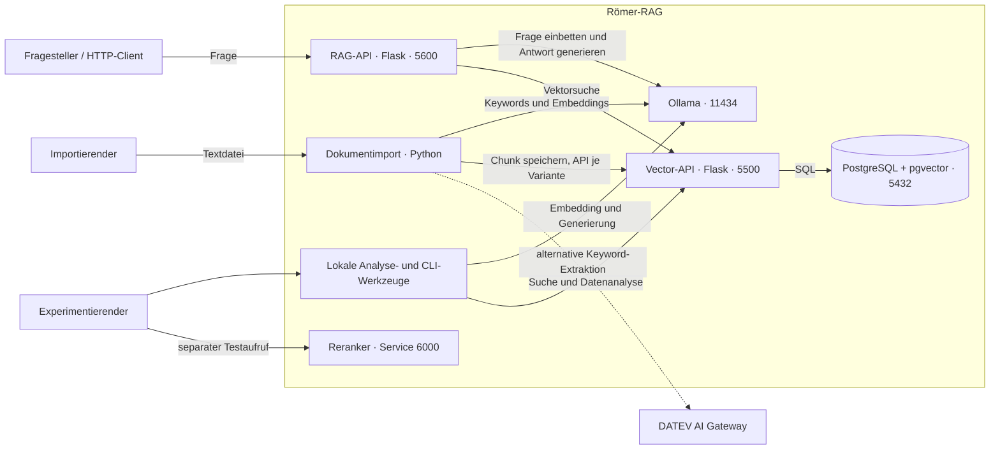
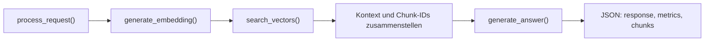

# Bausteinsicht nach arc42 – Römer-RAG

Stand: 08.11.2026. Grundlage ist die statische Analyse des Repositorys. Beschrieben wird die im Code und in den Kubernetes-Manifesten erkennbare Architektur; der tatsächliche Zustand eines laufenden Clusters wurde nicht geprüft. Das Dokument bildet Kapitel 5 (Bausteinsicht) mit ergänzenden Kontext-, Ablauf- und Deploymentinformationen ab.

## 5.1 Gesamtsystem als Blackbox

**Aufgabe:** Textquellen zur römischen Geschichte erschließen und Fragen anhand gefundener Textabschnitte beantworten. Das experimentelle Retrieval-Augmented-Generation-System kombiniert Dokumentimport, Embeddings, Vektorsuche und Sprachmodelle.

**Systemgrenze:** Zum System gehören lokale Import- und Analyseprogramme sowie die Dienste RAG-API, Vector-API, PostgreSQL/pgvector, Ollama und Reranker. Kubernetes, Modellquellen und das alternativ nutzbare DATEV AI Gateway sind Umgebung beziehungsweise externe Abhängigkeiten.

| Nachbar / Rolle | Eingabe an das System | Ausgabe / Nutzung |
|---|---|---|
| Fragesteller über HTTP-Client | Frage, Suchmetrik, Trefferanzahl, optional Embedding-Filter | Antwort, verwendete Chunk-IDs, Generierungsmetriken |
| Importierender / Administrator | UTF-8-Textdateien, optional Start-Chunk | gespeicherte Chunks und Embeddings, Konsolenausgabe und Fehlerprotokoll |
| Experimentierender | Fragen, Testtexte und Trefferlisten | Ähnlichkeitswerte, Antworten und Reranking-Ergebnisse |
| DATEV AI Gateway, optional | erhält Text und Extraktionsprompt | liefert Keywords; Alternative zur lokalen Ollama-Extraktion |
| Modell- und Paketquellen | Downloadanforderungen beim Aufbau / Start | Modelle, Python- und Systempakete sowie pgvector-Quellcode |

Zentrale Außenschnittstelle ist `POST /process` an Port 5600. Die lokalen Werkzeuge greifen außerdem direkt auf Ollama und Vector-API zu. Ein eigenes Webfrontend ist im Repository nicht enthalten.

## 5.2 Ebene 1 – Whitebox des Gesamtsystems

Die Importkante zur Vector-API beschreibt die implementierte Abhängigkeit. Die unterschiedlichen Endpunkte der Varianten verhindern derzeit ihre durchgängige Nutzung in jeder Kombination (siehe Abschnitt 5.6). Der Reranker ist ein eigenständiger experimenteller Baustein; es existiert kein Aufruf aus der RAG-API.

| Baustein | Verantwortung | Wesentliche Schnittstellen | Implementierung |
|---|---|---|---|
| Dokumentimport | Datei zerlegen, optional Keywords voranstellen, Embeddings normalisieren und speichern | Dateisystem; Ollama `/api/chat`, `/api/embeddings`; Vector-API | [import3.py](../Ingest/import3.py), [chunking.py](../Ingest/chunking.py), [keywords.py](../Ingest/keywords.py), [gateway.py](../Ingest/gateway.py); weitere Varianten `import.py`, `import2.py` |
| RAG-API | Fragebeantwortung orchestrieren; Kontext und Quellen-IDs zusammenstellen | `POST /process`; ausgehend Ollama und `/search` | Python-Code in [rag-configmap.yaml](../rag/k8s/rag-configmap.yaml) |
| Vector-API | Chunks verwalten und nach Vektorähnlichkeit suchen; Datenbankzugriff kapseln | HTTP/JSON, SQL über psycopg2 | Deploymentcode in [vectorapi-configmap.yaml](../Vector/k8s/vectorapi-configmap.yaml); abweichende lokale Variante [app.py](../Vector/app.py) |
| Vektorspeicher | Chunks, Modell-/Variantenkennung und 1024-dimensionale Vektoren persistent halten | PostgreSQL-Protokoll, Tabelle `vectors` | [init.sql](../Vector/init.sql), [deploy-vectordb.yaml](../Vector/k8s/deploy-vectordb.yaml) |
| Ollama | Embedding- und Sprachmodelle ausführen | `/api/embeddings`, `/api/generate`, `/api/chat` | [ollama.yaml](../Ollama/k8s/ollama.yaml) |
| Reranker | Frage-Dokument-Paare bewerten und absteigend sortieren | `POST /rerank`, `GET /health` | [configmap.yaml](../reranker/k8s/configmap.yaml), [reranker-local.py](../reranker/reranker-local.py) |
| Lokale Werkzeuge | RAG-Ablauf lokal ausführen, Retrieval und Modelle untersuchen | direkte HTTP-Aufrufe; JSON- und Textdateien | [interact.py](../interact.py), [analyze.py](../analyze.py), `Vector/analyze_data.py`, `Ingest/chunktest*.py`, Testskripte |

## 5.3 Ebene 2 – zentrale Bausteine

Die folgenden Unterbausteine sind logische Verantwortlichkeiten innerhalb der Skripte und Dienste; sie sind keine zusätzlichen Deploymenteinheiten.

### 5.3.1 Dokumentimport

| Unterbaustein | Aufgabe und Abhängigkeiten |
|---|---|
| Importsteuerung | `import3.py: process_file()` vergibt IDs `<Dateibasis>-<laufende Nummer>`, unterstützt `--start` und protokolliert Fehler pro Chunk. Nach einem Chunkfehler läuft die Verarbeitung weiter. |
| Chunking | `split_text_into_chunks()` liest UTF-8 und nutzt LangChains `RecursiveCharacterTextSplitter`. `import3.py` konfiguriert 1000 Zeichen und 150 Zeichen Überlappung; Trennzeichen berücksichtigen Absätze und Satzgrenzen. |
| Keyword-Extraktion | `keywords.py` erstellt Prompts und extrahiert Keywords. Der Import3-Pfad ruft Ollama über `gateway.py` auf und stellt das Ergebnis dem Originaltext voran. |
| Modelladapter | `gateway.py` kapselt Ollama-Chat mit `gemma3:4b` sowie alternativ das DATEV AI Gateway mit dem Deployment `gpt-4o`. Gateway-Zugangsdaten werden aus Umgebungsvariablen gelesen. |
| Embedding und Speicherung | `generate_embedding()` nutzt `snowflake-arctic-embed2` und normiert den Vektor. Gespeichert werden angereicherter Text und die Variantenkennung `snowflake-arctic-embed2-v2`. |

`import2.py` enthält die Keyword-Extraktion über das DATEV AI Gateway noch direkt im Skript. `import.py` ist eine einfachere Variante ohne Keyword-Anreicherung und enthält erkennbare Aufruffehler. Die Nummerierung der Dateien belegt keinen verbindlichen produktiven Einstiegspunkt.

### 5.3.2 RAG-API

| Unterbaustein | Verantwortung |
|---|---|
| HTTP-Einstieg | `process_request()` liest `query`, `filter`, `metric`, `num_results`; eine fehlende Frage ergibt HTTP 400, abgefangene Verarbeitungsfehler HTTP 500. |
| Embeddingadapter | Erzeugt und normalisiert das Frage-Embedding über Ollama mit `snowflake-arctic-embed2`. |
| Retrievaladapter | Sendet Vektor, Variantenfilter, Metrik und Trefferanzahl an Vector-API `/search`. Defaults: `snowflake-arctic-embed2`, `euclidean`, fünf Treffer. |
| Kontextbildung | Verknüpft die `metadata`-Texte der Treffer und sammelt ihre `chunk_id`-Werte. |
| Generierungsadapter | Übergibt Kontext und Frage an Ollama `/api/generate` mit `phi3:mini`, deaktiviert Streaming und bereitet Laufzeit-/Tokenmetriken auf. Der Systemprompt verlangt eine Antwort nur auf Basis des Kontexts; dies ist keine technische Garantie für Faktentreue. |

### 5.3.3 Vector-API und Datenhaltung

Die Vector-API umfasst HTTP-Routen, Suchlogik und einen PostgreSQL-Verbindungspool mit einer bis zehn Verbindungen. Sie übersetzt Suchparameter in SQL und gibt Treffer mit Text, Vektor und Distanz zurück.

**Schnittstellen der im Kubernetes-Deployment eingebundenen ConfigMap:**

| Methode / Pfad | Aufgabe |
|---|---|
| `GET /chunks?embedding=...` | Chunks zählen; Antwortfeld `chunks` |
| `GET /chunks/<chunk_id>?embedding=...` | Einzelnen Chunk lesen |
| `POST /vectors` | Datensatz mit `chunk_id`, `embedding`, `vector`, `metadata` ersetzen / speichern |
| `POST /search` | Ähnlichkeitssuche; Parameter `vector`, optional `embedding`, `metric`, `num_results` |

Die lokale `Vector/app.py` verwendet stattdessen `GET /chunk/<chunk_id>`, `POST /chunk`, zusätzlich `DELETE /chunk` und bei der Zählung das Antwortfeld `count`.

**Datenmodell:**

| Spalte | Bedeutung |
|---|---|
| `id SERIAL PRIMARY KEY` | Technische Zeilen-ID |
| `chunk_id TEXT NOT NULL` | Fachliche Chunkkennung |
| `embedding TEXT NOT NULL` | Modell-/Importvariantenkennung; kein Vektor |
| `vector VECTOR(1024)` | Embedding mit fester Dimension |
| `metadata TEXT` | Textinhalt, bei angereichertem Import einschließlich Keywords |

`UNIQUE(chunk_id, embedding)` trennt Importvarianten desselben Chunks. Schreiben erfolgt als Löschen und Einfügen innerhalb einer Transaktion. Der HNSW-Index verwendet `vector_l2_ops` für euklidische Distanz. Es gibt kein separates Dokument-, Benutzer- oder Berechtigungsmodell.

### 5.3.4 Ollama und Reranker

Ollama stellt dieselbe technische Modelllaufzeit für mehrere Aufgaben bereit: Embeddings (`snowflake-arctic-embed2`), Antwortgenerierung (`phi3:mini`) und Keyword-Extraktion (`gemma3:4b` im Import3-Pfad). Das Manifest lädt nur die ersten beiden Modelle vor; für Import3 muss `gemma3:4b` zusätzlich vorhanden sein.

Der Reranker enthält HTTP-Validierung, verzögertes Laden eines `CrossEncoder`, Paarbildung aus Frage und Dokument, Bewertung und Sortierung. Das Kubernetes-Deployment verwendet `cross-encoder/ms-marco-MiniLM-L6-v2`; das lokale Skript standardmäßig `BAAI/bge-reranker-v2-m3`. Die API liefert `ranked_documents` mit `original_index`, `score` und `text`. Eine Integration in den Retrievalpfad wäre eine zukünftige Änderung.

## 5.4 Wesentliche Abläufe

**Fragebeantwortung:** HTTP-Client → RAG-API → Ollama (Frage-Embedding) → Vector-API → PostgreSQL (Treffer) → RAG-API (Kontextbildung) → Ollama (Antwort) → HTTP-Client. Alle Modell- und Suchaufrufe erfolgen synchron.

**Import3:** Textdatei → Chunking → Ollama (Keywords) → Textanreicherung → Ollama (Embedding) → Normalisierung → Vector-API (Speicherung). Dieser Ablauf benötigt eine zur Importvariante passende Vector-API; das mitgelieferte Kubernetes-Manifest erfüllt den verwendeten Schreibpfad derzeit nicht.

**Lokale Fragebeantwortung:** `interact.py` übernimmt die Orchestrierung selbst und greift direkt auf Ollama und Vector-API zu. Es ist kein Client der RAG-API und setzt keinen Embedding-Filter. `analyze.py` ergänzt Ähnlichkeitsvergleiche und Retrievaldiagnose.

## 5.5 Zuordnung zur Laufzeitumgebung

Die Kubernetes-Manifeste definieren je eine Replik von RAG-API, Vector-API, PostgreSQL, Ollama und Reranker im Namespace `experimental`. Import- und Analysewerkzeuge laufen lokal; laut README werden Cluster-Dienste dafür per `kubectl port-forward` erreichbar gemacht.

RAG-API, Vector-API und Reranker laden Python-Code aus ConfigMaps nach `/app` und installieren Abhängigkeiten beim Start. Der Reranker-Service übersetzt Port 6000 auf den Anwendungsport 5000. PostgreSQL nutzt einen 8-Gi-PVC; Ollama speichert Modelle über `hostPath` unter `/opt/ollama` auf dem jeweiligen Knoten.

Die referenzierte `security-config` für Zertifikate und pip-Konfiguration sowie das im README erwähnte `global-setup` sind im Repository nicht enthalten. Ein vollständiger Neuaufbau benötigt diese extern bereitgestellten Voraussetzungen.

## 5.6 Architekturauffälligkeiten und offene Punkte

| Befund aus dem Repository | Auswirkung / Klärungsbedarf |
|---|---|
| Zwei unterschiedliche Implementierungen der Vector-API | `import2.py` und `import3.py` schreiben auf `/chunk`; die deployte ConfigMap bietet `/vectors`. Ohne Anpassung scheitert dieser Import am Endpunkt. Eine gemeinsame Implementierungsquelle und ein verbindlicher API-Vertrag fehlen. |
| Importvariantenkennung und RAG-Standardfilter unterscheiden sich | Import2/3 speichern unter `snowflake-arctic-embed2-v2`; `/process` sucht standardmäßig unter `snowflake-arctic-embed2`. Die neu importierten Daten werden damit nicht ausgewählt. Der Requestfilter muss zur gespeicherten Variante passen. |
| Vektorformat zwischen HTTP und SQL uneinheitlich | RAG und Import senden JSON-Listen; SQL verwendet teilweise einen direkten `::VECTOR`-Cast, die lokale API dokumentiert dagegen einen String. Die tatsächliche Konvertierung mit psycopg2/pgvector muss durch einen Integrationstest geklärt werden. |
| Suchzweig `cosine` verwendet im Code `<#>` | Der Zweig ist auf negatives inneres Produkt ausgelegt; der Name suggeriert Cosinusdistanz. Operator und Indexkonfiguration sollten mit dem gewünschten Suchvertrag abgeglichen werden. |
| Reranker ist vorhanden, aber unverbunden | Die RAG-Antwort basiert unmittelbar auf den Vektortreffern. Ein Qualitätsgewinn durch Reranking ist für diesen Pfad nicht implementiert. |
| Fehlerbehandlung im Datenbankzugriff unvollständig | Bei SQL-Fehlern erfolgt kein explizites Rollback vor Rückgabe an den Pool. Im ConfigMap-Code referenziert `except psycopg2.Error` zudem einen nicht importierten Modulnamen. |
| Startabhängigkeiten sind nicht reproduzierbar festgeschrieben | Unversionierte Python-Pakete, `latest`-Images und pgvector-Build beim Start können Verhalten verändern. PostgreSQL-Artefaktpfade sind zugleich auf Version 17 bzw. pgvector 0.8.0 festgelegt. |
| Authentifizierung ist in den Flask-Routen nicht implementiert; DB-Zugangsdaten stehen in Manifesten | Für einen Einsatz über die experimentelle Umgebung hinaus fehlen im Anwendungscode Zugriffskontrolle und eine getrennte Verwaltung der DB-Geheimnisse. |
| Betriebsabsicherung nur teilweise vorhanden | Keine Readiness-/Liveness-Probes in den betrachteten Deployments; viele HTTP-Aufrufe ohne Timeout. Fehler und langsame Abhängigkeiten können Anfragen und Startverhalten beeinträchtigen. |
| RAG-Deployment deklariert `containerPort: 5500` | Anwendung und Service verwenden 5600. Die Portdeklaration ist inkonsistent; der Service zielt bereits auf den Anwendungsport. |

Das vorhandene [Structurizr-Modell](../workspace.dsl) bestätigt den grundlegenden RAG- und Importpfad, bildet jedoch Reranker, Keyword-Extraktion und die Implementierungsvarianten nicht ab. Die obige Sicht ergänzt diese anhand des Quellcodes.

## Quellen und Prüfumfang

Analysiert wurden README, `workspace.dsl`, Python-Implementierungen, SQL-Schema, ConfigMaps, Deployments und Services. Entscheidend für die dargestellte Deploymentvariante sind die tatsächlich gemounteten ConfigMaps. Es wurden weder Modelle geladen noch Imports, API-Aufrufe oder Deployments ausgeführt. Die genannten Inkonsistenzen sind statische Befunde; die Funktionsfähigkeit eines konkreten Betriebsstands ist damit nicht nachgewiesen.
