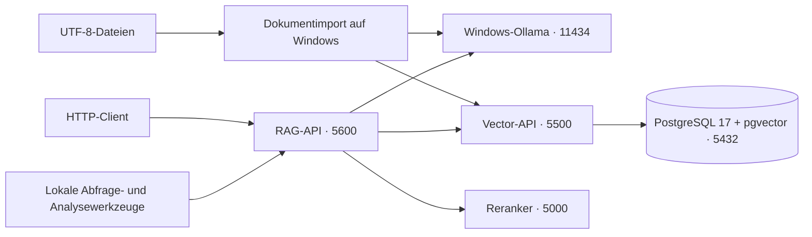

<!--

purpose: "Statische Zerlegung des Systems in Bausteine mit Verantwortlichkeiten, Schnittstellen und Abhängigkeiten."
agent_instructions:
  - Dies ist Teil einer  Architekturdokumentation nach Arc42
  - "Das Gesamtsystem auf der obersten Ebene als Whitebox zeigen und seine Bausteine als Blackboxes mit Zweck, Verantwortung und relevanten Schnittstellen erklären. Nur wichtige Bausteine auf weiteren Ebenen verfeinern und auf die Implementierung verweisen."
  - "Interne statische Beziehungen hier pflegen und für externe Systemgrenzen (3), zeitliche Interaktionen (6) und Infrastrukturzuordnung (7) auf die jeweiligen Sichten verweisen."
  - "In diesem Kapitel nur den aktuellen Stand und ausdrücklich als offen gekennzeichnete Ziele beschreiben."
  - "Weiterhin gültige Änderungen direkt in den fachlich passenden Abschnitt einarbeiten und überholte Aussagen ersetzen."
  - "Keine datierten Nachträge, Änderungshistorie, Prüfergebnisse oder Ausrollstände in dieses Kapitel aufnehmen. Diese ausschließlich in ../changelog.md dokumentieren."

-->

# 5 Bausteinsicht – Römer-RAG

Die [Lösungsstrategie](4-loesungsstrategie.md#verantwortlichkeiten-und-abhängigkeiten) erläutert die Prinzipien, nach denen Zuständigkeiten und Abhängigkeiten der Bausteine festgelegt sind.

Die [Laufzeitsicht](6-laufzeitsicht.md) beschreibt Aufrufreihenfolge und Netzwerkverhalten. Die [Verteilungssicht](7-verteilungssicht.md) ordnet die Bausteine Hosts, Pods und Containern zu. Das [README](../README.md) enthält Setup und Startbefehle.

## 5.1 Gesamtsystem als Blackbox

Das System erschließt Texte zur römischen Geschichte und beantwortet Fragen anhand abgerufener Textabschnitte. Es dient der experimentellen Bewertung von Import-, Retrieval- und Modellstrategien. Ein eigenes Webfrontend ist nicht enthalten.

| Nachbar / Rolle | Eingabe | Ausgabe / Nutzung |
|---|---|---|
| Fragesteller über HTTP | Frage, Set, Metrik, Trefferanzahl und optionale Reranking-Parameter | Antwort, Treffer und Laufzeitmetriken |
| Importierender | UTF-8-Dateien, optional Start-Chunk | gespeicherte Chunks und Embeddings, Zwischenartefakte und Startnummer bei Fehlern |
| Experimentierender | Fragen, Texte und Trefferlisten | Retrievaldiagnose, Modell- und Reranking-Ergebnisse |
| Image-, Modell- und Paketquellen | Downloads beim Build bzw. Modellbereitstellen | Basisimages, Python-Pakete und Modellgewichte |

Die zentrale Außenschnittstelle ist `POST /process` der RAG-API auf Containerport 5600. Der Dokumentimport greift direkt auf Ollama und Vector-API zu. Ollama läuft im beschriebenen Windows-Betrieb als Hintergrund-App außerhalb der Linux-Container.

## 5.2 Ebene 1 – Whitebox

| Baustein | Verantwortung | Maßgebliche Implementierung |
|---|---|---|
| Dokumentimport | Chunking, optionale Keyword-Anreicherung, konfigurierbare Embeddings und Speicherung | [pipeline.py](../Ingest/pipeline.py), [chunking.py](../Ingest/utils/chunking.py) |
| RAG-API | Embedding, Retrieval, optionales Reranking, Kontext und Generierung orchestrieren | [app.py](../rag/app.py), [ollama_endpoint.py](../rag/ollama_endpoint.py), [Dockerfile](../rag/Dockerfile) |
| Vector-API | CRUD und Ähnlichkeitssuche über PostgreSQL | [app.py](../Vector/app.py), [Dockerfile.api](../Vector/Dockerfile.api) |
| Vektorspeicher | Chunks, Varianten und Vektoren persistent speichern | [init.sql](../Vector/init.sql), [Dockerfile](../Vector/Dockerfile) |
| Ollama | Embedding-, Antwort- und Keyword-Modelle ausführen | Windows-Hintergrund-App; Bereitstellung gemäß README |
| Reranker | Frage-Dokument-Paare bewerten und sortieren | [app.py](../reranker/app.py), [Dockerfile](../reranker/Dockerfile) |
| Lokale Werkzeuge | Abfragen und Analysen über die RAG-API | [interact.py](../interact.py), [analyze.py](../analyze.py) |

Die Endpunkte validieren und dekodieren ihre Eingaben vor Datenbank- oder Modellzugriffen. Die Vector-API und der RAG-Retrievalschritt verwenden gemeinsame Prüfungen für den [Vector-Suchvertrag](../rag_common/vector_contract.py). Die Ergebnisvalidierung und die Zugriffe auf Provider, Datenbank und Modelle melden Fehler über Python-Ausnahmen ihrer jeweiligen Schicht. Die Flask-Apps ordnen ihnen an der HTTP-Grenze Problemtypen zu. [rag_common/http_errors.py](../rag_common/http_errors.py) erzeugt daraus RFC-9457-Problemantworten mit stabiler Typ-URI und Request-ID. Die [Fehlerverträge](8-3-error-handling.md) beschreiben die Regeln im Detail.

## 5.3 Ebene 2 – zentrale Bausteine

### 5.3.1 Dokumentimport

`Ingest.pipeline` liest die Versuchskonfiguration und verwendet rekursives Chunking, optionale Keyword-Anreicherung und normalisierbare Embeddings. Versionierte Zwischenartefakte erlauben die Wiederverwendung bereits erzeugter Chunks oder Anreicherungen. Chunks haben IDs aus Dateistamm und Nummer ab 1. Die Pipeline schreibt jeden Chunk über `POST /vectors` und bereinigt nach erfolgreichem Abschluss überzählige Chunks mit `DELETE /chunks`. Bei Abbruch bleiben bestätigte Chunks abrufbar und die Pipeline gibt den Wert für `--start` aus. Dienstadressen werden über `OLLAMA_HOST_URL` und `IMPORT_VECTOR_URL` konfiguriert. Aufrufe und Artefakte beschreibt das [Importkonzept](8-4-importkonzept.md).

### 5.3.2 RAG-API

| Teil | Verantwortung / Konfiguration |
|---|---|
| [HTTP-Einstieg](../rag/app.py) | `POST /process` liest `query`, `embedding_set_id`, `metric`, `num_results` und optionale Modell- und Reranking-Parameter. Der Set-Default ist über `EMBEDDING_SET_ID` konfigurierbar und steht auf `snowflake-arctic-embed2-v2`. Standard sind Metrik `euclidean` und fünf Treffer. |
| Ollama-Resolver | `OLLAMA_BASE_URL` hat Vorrang. Sonst Prüfung des Podman-Hostnamens und unter WSL der sichtbaren IPv4-Default-Gateways über `/api/tags`. Erfolgreiche Auswahl wird pro Prozess gespeichert. |
| [Embedding](../rag/embedding.py) | Ruft `/api/embeddings` mit dem über `EMBEDDING_MODEL` konfigurierten Modell (Standard `snowflake-arctic-embed2`) auf, normalisiert den Fragevektor und bietet den Vergleich von Embeddings an. |
| [Retrieval](../rag/retrieval.py) | Ruft `POST /search` der Vector-API auf, validiert Treffer und berechnet bei Bedarf Distanzdiagnosen. `VECTOR_API_URL` verwendet standardmäßig `http://host.containers.internal:5500/search`. |
| [Reranking](../rag/reranking.py) | Filtert leere Treffertexte und ruft bei nutzbaren Treffern und `top_k > 0` den über `RERANKER_URL` konfigurierten Dienst auf. Standardmäßig ist Reranking für `/process` deaktiviert. |
| [Generierung](../rag/generation.py) | Bildet den Kontext und ruft `/api/generate` für Antwort, Laufzeit- und Tokenmetriken ohne Streaming auf. Das Antwortmodell lässt sich je Anfrage wählen. `ANSWER_MODEL` konfiguriert den Standard (`gemma4:e4b`). |
| [Providertransport](../rag/transport.py) | Führt ausgehende HTTP-Aufrufe mit Zeitlimits und schrittabhängigen Wiederholungen aus. Die Flask-Grenze übergibt die Request-ID. |

Die Antwort enthält `response`, `chunks`, `metrics` sowie getrennte `retrieved_results` und `selected_results`. Leerer Kontext führt zu HTTP 200 mit `status: no_context`, leeren `chunks` und `metrics: null`. Ungültige Retrievalantworten ergeben HTTP 502. Die Serverzeiten `embedding_duration`, `retrieval_duration` und `pipeline_duration` stehen in `timings`, auch bei `no_context`. Generierungsmetriken verwenden `generation_duration` mit `total_duration` als Alias. Ungültige optionale Metriken werden als `null` ausgegeben. Der Prompt begrenzt die Antwort auf den Kontext. Ein erfolgreicher API-Aufruf garantiert keine Faktentreue.

`POST /process` ruft die Business-Funktionen für Frageembedding, Retrieval, Trefferauswahl und Generierung in dieser Reihenfolge auf. Die Evaluationsendpunkte `POST /evaluate/retrieve`, `POST /evaluate/rerank` und `POST /evaluate/generate` rufen dieselben Funktionen für ihre jeweiligen Schritte auf. Trefferauswahl und Generierung verwenden denselben Filter für leere Texte. Der Generierungsschritt bildet den Kontext und liefert bei fehlendem Kontext die Ersatzantwort. Die HTTP-Handler validieren Eingaben und formatieren die jeweilige Antwort.

`next_request` verbindet die Evaluationsschritte über serialisierbare Eingaben. Trefferidentität und Trefferfelder bleiben erhalten. `/evaluate/retrieve` fordert Treffervektoren nur für `include_distances: true` an und liefert daraus berechnete Diagnosen. Der Fragevektor ist mit `include_query_vector: true` abrufbar. Trefferausgabe und Folgeaufrufe aus Retrieve enthalten keine Vektoren. Die Endpunkte speichern weder Vektoren noch Sitzungszustand.

`interact.py` validiert CLI-Argumente, ruft `/process` auf und übernimmt Ausgabe und lokalen Export. `analyze.py` ruft `/evaluate/retrieve` mit Distanzdiagnostik auf und übergibt `next_request` an `/evaluate/generate`. RAG berechnet Cosinus-Ähnlichkeit und euklidischen Abstand für die Treffer und optional für den vom Analysewerkzeug übergebenen Gold-Chunk. Die [Laufzeitsicht](6-laufzeitsicht.md) beschreibt Aufrufreihenfolge und Netzwerk. [Zeitlimits und Wiederholungsregeln](8-3-error-handling.md#834-timeouts-und-wiederholungen)

### 5.3.3 Vector-API und Datenhaltung

Die Vector-API initialisiert den `ThreadedConnectionPool` beim ersten Datenbankzugriff. Bei fachlichen Anfragen erfolgt dieser Zugriff nach der Eingabevalidierung. Der Pool umfasst eine bis zehn Verbindungen. Der Transaktionskontext führt Commit oder Rollback aus und verwirft defekte Verbindungen. Einstellungen sind `POSTGRES_DB`, `DB_HOST`, `DB_PORT`, `DB_USER` und `DB_PASSWORD`. [Zeitlimits und Initialisierungsversuche](8-3-error-handling.md#834-timeouts-und-wiederholungen)

`GET /actuator/health` prüft den lesenden Zugriff auf die benötigten Spalten in `vectors`. `GET /actuator/info` meldet, ob der Verbindungspool initialisiert ist, und listet die in `vectors` vorhandenen Embedding-Set-IDs. Fehlende Bereitschaft und Poolerschöpfung ergeben HTTP 503. Nach einem Datenbankwiederanlauf kann sich die API ohne Neustart erholen.

| Methode / Pfad | Aufgabe |
|---|---|
| `GET /chunks?embedding_set_id=...` | Zeilen zählen; Antwortfeld `chunks`, Filter optional |
| `GET /chunks/<chunk_id>?embedding_set_id=...` | Einzelnen Chunk aus dem angegebenen Set lesen. `include_vector=true` liefert den gespeicherten Vektor mit. |
| `POST /vectors` | Datensatz anhand von `chunk_id` und `embedding_set_id` per Upsert speichern und interne ID bei Updates erhalten. HTTP 201 |
| `GET /find?query=...&embedding_set_id=...` | Chunk-IDs im angegebenen Set anhand eines case-insensitiven Musters in `chunktext` (`ILIKE`) finden |
| `DELETE /chunks` | Kanonische Chunknummern in einem Dokument und Set im inklusiven Bereich `from` bis `to` löschen |
| `POST /search` | Suche mit `vector`, `embedding_set_id`, optional `metric`, `num_results` und boolesches `include_vector`; `euclidean` (`<->`) und `cosine` (`<=>`) werden unterstützt, ungültige Metriken liefern HTTP 400 |

Der JSON-Body für `DELETE /chunks` enthält `document_id` (Dateistamm), `embedding_set_id` und die positive Ganzzahl `from`. `to` ist optional und muss als Ganzzahl mindestens so groß wie `from` sein. Gleiche Grenzen löschen einen einzelnen Chunk. Ohne `to` reicht der Bereich bis zum Ende. IDs im Format `<Dateistamm>-<Nummer ab 1>` werden exakt dem Dokument zugeordnet. HTTP 200 gibt mit `{"deleted": 2}` die Anzahl gelöschter Zeilen an. Ungültige Angaben ergeben HTTP 400.

Die Tabelle `vectors` enthält `id SERIAL PRIMARY KEY`, `chunk_id TEXT NOT NULL`, `embedding_set_id TEXT NOT NULL`, `vector VECTOR(1024)` und `chunktext TEXT NOT NULL`. Ein Check-Constraint verlangt mindestens ein Zeichen außerhalb von Leerzeichen, LF und CR. Die Vector-API prüft dieselbe Regel vor dem Datenbankzugriff. `embedding_set_id` ist die Variantenkennung, kein numerischer Vektor. `UNIQUE(chunk_id, embedding_set_id)` trennt Importvarianten. Einzelwrites verwenden Upserts und sind nach der jeweiligen Transaktion abrufbar. Die abschließende Bereinigung verwendet eine eigene Transaktion. HNSW-Indizes mit `vector_l2_ops` und `vector_cosine_ops` unterstützen die euklidische Suche und die Cosinus-Suche. Die Vector-API akzeptiert Vektoren als JSON-Zahlenlisten mit 1024 endlichen Zahlen. Die Vector-API verwendet `embedding_set_id` als Set-Kennung in Anfragen und Antworten. Angeforderte Vektoren werden wie der RAG-Fragevektor als JSON-Zahlenlisten ausgegeben.

Das [Initialisierungsschema](../Vector/init.sql) definiert die Tabelle, ihre Constraints und Indizes für neue Datenbanken.

### 5.3.4 Ollama und Reranker

Für den RAG-Standardbetrieb stellt Ollama `snowflake-arctic-embed2` für Embeddings und `gemma4:e4b` für Antworten bereit. Die Importpipeline wählt Embedding- und gegebenenfalls Keyword-Modell aus der Versuchskonfiguration. Die Modelle liegen auf dem Windows-Host.

Das Reranker-Image installiert Flask, sentence-transformers und torch und laedt beim Build `cross-encoder/ms-marco-MiniLM-L6-v2` vor. `POST /rerank` akzeptiert optional `model`; ohne Angabe gilt `RERANK_MODEL`. Ein aktiver CrossEncoder wird bei gleicher Auswahl wiederverwendet und bei Modellwechsel ersetzt. Laden und Inferenz sind gemeinsam synchronisiert. Neue Gewichte werden bei Bedarf geladen; Modelle mit erforderlichem Remote-Code werden nicht unterstuetzt (`trust_remote_code=False`). Ladefehler liefern HTTP 503 ohne Fallback. Antworten enthalten das verwendete `model` und `ranked_documents` mit `original_index`, `score` und `text`, absteigend sortiert. Leere Dokumentlisten laden kein Modell. Der Prozess lädt das Defaultmodell beim Start im Hintergrund. Die Health-Endpunkte lesen den Modellzustand unabhängig von der Inferenzsperre.

Alle drei APIs verwenden den [gemeinsamen Health-Vertrag](8-3-error-handling.md#gemeinsamer-health-vertrag-ts-13).
