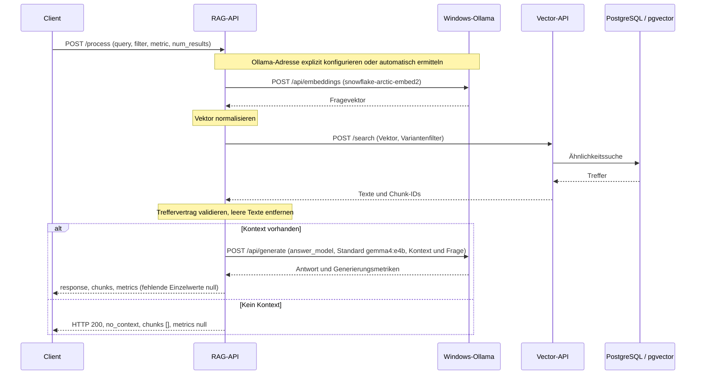
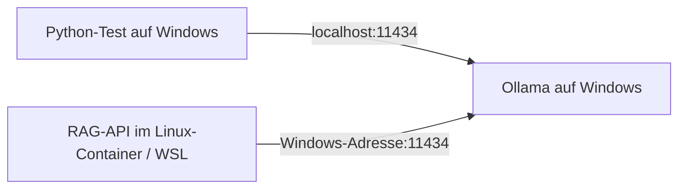

# 6 Laufzeitsicht nach arc42 – Römer-RAG

Stand: 15.11.2026. Diese Sicht beschreibt Fragebeantwortung, Dokumentimport und die dabei benötigte Verbindung zu Windows-Ollama im Podman-Betrieb. Die [Bausteinsicht](5-bausteinsicht.md) beschreibt die Komponenten; Startbefehle stehen im [README](../README.md).

## 6.1 Fragebeantwortung



Die Aufrufe erfolgen synchron. Die CLI ruft ausschliesslich `/process` auf. Die API erzeugt das Embedding, liest Treffer, entfernt leere Texte, ruft bei top_k > 0 den Reranker auf und generiert aus den ausgewaehlten Texten. Leerer Kontext vor oder nach Reranking ergibt no_context ohne Generierung. Urspruengliche Treffer werden fuer lokalen CLI-Export zurueckgegeben; nach spaeteren Fehlern erfolgt kein Export. Modellwahl ist pro Anfrage explizit moeglich. Konfigurierbare Verbindungs-/Lesezeitlimits und ein Restbudget begrenzen Folgeaufrufe. Nur Embedding, Retrieval und Reranking werden bei Transportfehler hoechstens einmal wiederholt; Generierung nie. Fehler tragen die Stufe embedding, retrieval, reranking oder generation und sichere Problem Details. Details zu Parametern und Zeitlimits: README.

Import3 und RAG verwenden gemeinsam `EMBEDDING_SET_ID=snowflake-arctic-embed2-v2`. `embedding_set_id` ersetzt den RAG-Parameter `filter`, der kompatibel bleibt. Treffer werden vor der Kontextbildung validiert; leere Texte werden danach entfernt. Bleibt kein Kontext, endet die Anfrage ohne Generierung mit HTTP 200, `status: no_context`, `chunks: []` und `metrics: null`. Einzelne nicht verfügbare oder ungültige Generierungsmetriken sind bei vorhandener Antwort null.

## 6.2 Dokumentimport und E2E-Test

`Ingest/import3.py` liest eine UTF-8-Datei, zerlegt sie in Chunks, erzeugt Keywords mit `gemma3:4b`, stellt diese dem Text voran, erzeugt und normalisiert Embeddings mit `snowflake-arctic-embed2` und speichert sie über `POST /vectors`. Chunks lassen sich über `GET /chunks/<chunk_id>` lesen; `GET /chunks` zählt Datensätze und liefert das Feld `chunks`. `GET /find?query=...` sucht Chunk-IDs anhand eines case-insensitiven `ILIKE`-Musters in den Metadaten. Die Suche unterstützt `euclidean` und `cosine`; `DELETE /chunks` entfernt Test- oder Importdatensätze. IDs haben das Format `<Dateibasis>-<laufende Nummer>`. Ein Chunkfehler wird protokolliert; danach läuft der Import weiter. Die Importskripte laufen auf Windows und verwenden eigene, im Skript konfigurierte URLs.

Der E2E-Test nutzt einen kleineren Ablauf ohne Keyword-Anreicherung: Modelle vom Host und Container prüfen → versionierte Textdatei zerlegen → echte Embeddings normalisieren → in die isolierte Testdatenbank importieren → `/process` aufrufen → Quellen, Antwortinhalt und Metriken prüfen → Testdaten löschen. Er führt `import3.py` nicht aus. Testgrenzen und Optionen stehen im [Testkonzept](8-1-testkonzept.md).

## 6.3 Ollama über die Windows-/WSL-Netzwerkgrenze erreichen

Die [Verteilungssicht](7-verteilungssicht.md) ordnet die beteiligten Prozesse Windows, WSL und den Pods zu und dokumentiert Hostports, Containerports und Speicherorte.

### Warum localhost nicht immer dasselbe Ziel ist

Ollama läuft hier als Windows-Hintergrund-App. Die RAG-API läuft in einem Linux-Container innerhalb der Podman-Machine. Unter Windows verwendet diese Machine in unserer Umgebung WSL2, also eine separate Linux-Umgebung. Obwohl alles auf demselben Rechner läuft, sind das unterschiedliche Netzwerkumgebungen.

`localhost` bedeutet immer „diese Netzwerkumgebung“. Eine Anfrage aus PowerShell an `localhost:11434` erreicht Windows-Ollama. Dieselbe Adresse im RAG-Container sucht dagegen einen Dienst im Container beziehungsweise dessen Pod. Container im selben Pod teilen ihre Netzwerkumgebung; deshalb kann die RAG-API die Vector-API dort über `127.0.0.1:5500` erreichen. Windows-Ollama läuft außerhalb dieses Pods.



Deshalb kann `test_ollama_embedding.py` grün sein, während der E2E-Test scheitert: Der Embedding-Test läuft auf Windows. Der E2E-Test benötigt zusätzlich den Netzwerkweg aus dem RAG-Container.

### Wozu der Gateway benötigt wird

Podman bietet den Namen `host.containers.internal` für den Zugriff auf den Host an. In unserer WSL-Konfiguration erreichten wir darüber jedoch nicht Windows-Ollama. Bei der Fehlersuche zeigte der Name im Container auf `169.254.1.2`; Ollama war stattdessen über `172.24.64.1` erreichbar. Das sind beobachtete Beispieladressen, keine festen Konfigurationswerte.

Die erreichbare Adresse war der Windows-Gateway des WSL-Netzes. Ein Gateway ist der nächste Netzwerkrechner, an den eine Umgebung Verkehr außerhalb ihres eigenen Netzes schickt. Im hier verwendeten WSL-NAT-Betrieb ist dieser Übergang auf der Windows-Seite erreichbar. Der Container kann darüber auch Ollama auf Windows ansprechen.

Nach einem WSL-Neustart kann diese Adresse anders lauten. Eine fest eingetragene IP müsste dann manuell angepasst werden. Deshalb ermittelt die Anwendung die erreichbare Adresse selbst.

### Was die Anwendung automatisch macht

Die Implementierung liegt in [rag/ollama_endpoint.py](../rag/ollama_endpoint.py). Sie gilt sowohl für den regulären RAG-Betrieb als auch für die E2E-Vorabprüfung:

1. Eine ausdrücklich gesetzte `OLLAMA_BASE_URL` hat Vorrang. Dann findet keine automatische Auswahl statt.
2. Andernfalls prüft der Resolver `http://host.containers.internal:11434/api/tags`.
3. Unter WSL prüft er zusätzlich die IPv4-Default-Gateways aus der Linux-Routingtabelle `/proc/net/route`. Die Routing-Metrik bestimmt die Reihenfolge; kleinere Werte kommen zuerst.
4. Der erste Endpunkt, der eine Ollama-Modellliste liefert, wird übernommen. Embeddings und Antwortgenerierung verwenden diese gemeinsame Basisadresse.

Die erfolgreiche Auswahl wird für die Lebensdauer des Python-Prozesses gespeichert. Scheitert die gesamte Auswahl, versucht der nächste Request es erneut. Fällt ein bereits ausgewählter Server später aus oder ändert sich seine Adresse, den RAG-Container neu starten, damit er die Auswahl erneut durchführt.

Die Automatik funktioniert nur mit den im Container sichtbaren Routen. Bei einer eigenen Container-Bridge kann deren Gateway statt des Windows-Gateways sichtbar sein. Für solche Netze oder einen entfernten Ollama-Server kann `OLLAMA_BASE_URL` beim Containerstart explizit gesetzt werden. Der Resolver ändert weder Firewallregeln noch Ollamas Netzwerkbindung.

### Was auf Windows eingerichtet sein muss

Zwei Voraussetzungen müssen gleichzeitig erfüllt sein: Die RAG-API muss die richtige Zieladresse verwenden, und Ollama muss dort Verbindungen annehmen. Lauscht Ollama nur auf Windows-`localhost`, hilft auch die korrekte Gateway-Adresse nicht.

Für die gewöhnliche Windows-Hintergrund-App einmalig in PowerShell setzen:

```powershell
[Environment]::SetEnvironmentVariable("OLLAMA_HOST", "0.0.0.0:11434", "User")
```

Danach Ollama über das Tray-Menü vollständig beenden und über das Startmenü neu starten, damit der neue Prozess die Benutzervariable übernimmt. Die Benutzereinstellung bleibt nach einem Host-Neustart erhalten.

`0.0.0.0` ist eine Bindungsangabe: Ollama soll Verbindungen auf allen IPv4-Schnittstellen annehmen. Diese Angabe ist keine Zieladresse für HTTP-Clients. Den Zugriff über die Windows-Firewall auf die benötigte Umgebung begrenzen.

### Die Einstellungen auseinanderhalten

| Variable | Wo wird sie gesetzt? | Zweck |
|---|---|---|
| `OLLAMA_HOST` | Windows-Benutzerumgebung des Ollama-Prozesses | Legt fest, an welchen Schnittstellen Ollama Verbindungen annimmt. |
| `OLLAMA_BASE_URL` | Umgebung des regulären RAG-Containers | Optionales festes Ziel; überschreibt die automatische Ermittlung. |
| `OLLAMA_CONTAINER_URL` | PowerShell beim Start der Tests | Optionales festes Testziel; wird als `OLLAMA_BASE_URL` an den Testcontainer weitergereicht. Ohne diese Variable verwendet er die Automatik. |
| `OLLAMA_HOST_URL` | PowerShell beim Start der Tests | Adresse für den E2E-Import auf Windows; Standard `http://localhost:11434`. |

Host-Import und Testcontainer müssen denselben Ollama-Server mit den benötigten Modellen erreichen. Eine alte manuelle Testadresse lässt sich mit `Remove-Item Env:OLLAMA_CONTAINER_URL -ErrorAction SilentlyContinue` entfernen.

### Bei Verbindungsfehlern gezielt prüfen

Die beiden Netzwerkwege getrennt prüfen, aus dem Projektstamm:

```powershell
# 1. Windows erreicht Ollama lokal.
Invoke-RestMethod http://localhost:11434/api/tags
# 2. Der RAG-Container ermittelt und erreicht einen Ollama-Endpunkt.
podman exec rag-api python -c "from ollama_endpoint import resolve_ollama_base_url; import urllib.request; u=resolve_ollama_base_url(); print(u); print(urllib.request.urlopen(u+'/api/tags',timeout=10).status)"
```

Der zweite Befehl soll eine Basisadresse und Status `200` ausgeben. Er startet einen eigenen Prüfprozess; die laufende RAG-API speichert ihre Auswahl unabhängig davon.

| Beobachtung | Nächster Schritt |
|---|---|
| Bereits der Windows-Aufruf scheitert | Prüfen, ob die Ollama-App läuft und Port 11434 verwendet. |
| Windows funktioniert, Container scheitert | Ollama-Bindung, Zieladresse aus dem Resolver und Netzwerk-/Firewallregeln prüfen. |
| Modellliste erreichbar, E2E-Test meldet fehlende Modelle | `ollama pull snowflake-arctic-embed2` und `ollama pull phi3:mini` auf dem verwendeten Server ausführen. |
| Prüfprozess funktioniert, laufende RAG-API verwendet noch ein altes Ziel | RAG-Container neu starten; explizite Containerkonfiguration ebenfalls prüfen. |

„Connection refused“ allein beweist keine bestimmte Ursache. Im beobachteten Fehlerfall war der falsche Netzwerkweg entscheidend: Über den Windows-Gateway funktionierten Modellliste, Embeddings und anschließend der E2E-Test mit der Ollama-Hintergrund-App.

Seit der Chunktext-Migration liest die Kontextbildung `chunktext` aus Suchtreffern. Import und Reranking reichen den Text unter diesem Namen weiter; `/find` durchsucht dieselbe Spalte. Der alte Feldname wird nicht als Alias angeboten.

## Laufzeitmessung der RAG-Pipeline

Die RAG-API misst mit time.monotonic die Abschnitte Embedding (einschliesslich Aufloesung, Normalisierung und Retries) und Retrieval (einschliesslich Trefferpruefung und Textfilterung). timings.pipeline_duration misst vom Beginn der Verarbeitung nach Eingangsvalidierung bis unmittelbar vor JSON-Antwortaufbau alle Schritte einschliesslich optionalem Reranking, Kontextbildung und Generierung. Antwortserialisierung, Uebertragung und CLI-Export gehoeren nicht dazu. timings steht auch bei no_context zur Verfuegung; Fehlerantworten enthalten keine Teillaufzeiten. Alle API-Zeiten sind ungerundete Sekunden. metrics.generation_duration stammt hingegen aus Ollamas total_duration und kann von der serverseitig gemessenen Generierungswartezeit abweichen. metrics.total_duration bleibt als kompatibler Alias erhalten.

## Schrittweise Evaluation

Retrieve fuehrt nur Embedding und Suche aus oder verwendet einen gespeicherten Query-Vektor. Seine Antwort enthaelt die Treffer und eine vollstaendige Reranking-Eingabe unter next_request. Rerank verwendet ausschliesslich uebergebene Texte, behaelt Chunkidentitaet und Trefferfelder, ergaenzt Scores und erzeugt die Generierungseingabe unter next_request. Generate verwendet ausschliesslich uebergebenen Kontext, Frage, Modell und Promptvorlagen. Jeder Schritt ist unabhaengig wiederholbar; Retrieval und Reranking muessen nicht fuer jede Modell-/Promptvariation erneut laufen. Leerer Kontext verhindert Provideraufrufe. Laufzeiten werden pro Aufruf gemessen; vorher gespeicherte Messwerte werden nicht als aktuelle Laufzeiten ausgegeben.
