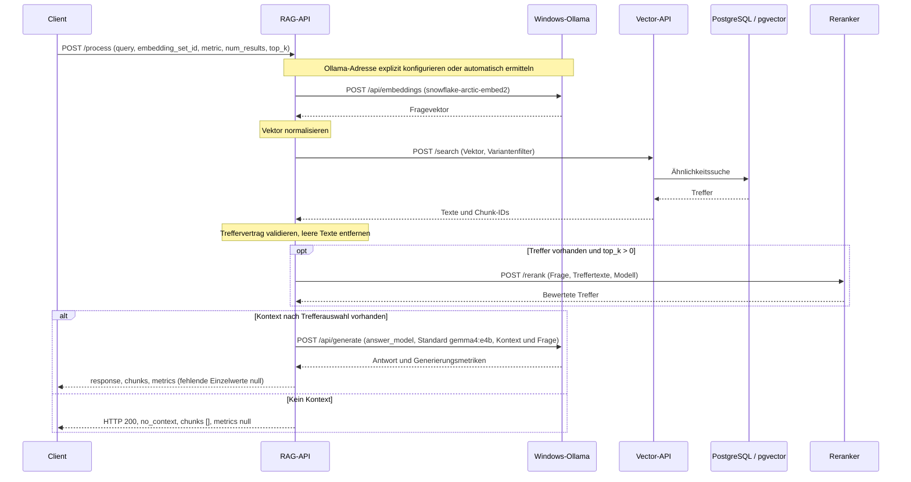
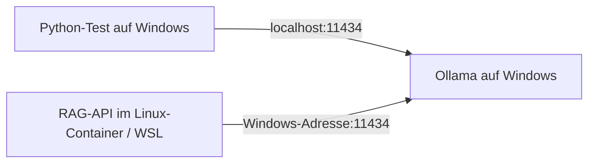

<!--

purpose: "Architekturrelevante Szenarien und Interaktionen der Bausteine zur Laufzeit."
agent_instructions:
  - "Wenige repräsentative fachliche, externe, betriebliche oder Fehlerabläufe auswählen. Beteiligte Bausteine und die wesentliche Reihenfolge und Wirkung ihrer Interaktionen zeigen."
  - "Bausteinnamen aus Kapitel 5 verwenden. Für statische Zuständigkeiten auf Kapitel 5, für Topologie auf Kapitel 7 und für Setup oder Diagnosebefehle auf die README verweisen."
  - "In diesem Kapitel nur den aktuellen Stand und ausdrücklich als offen gekennzeichnete Ziele beschreiben."
  - "Weiterhin gültige Änderungen direkt in den fachlich passenden Abschnitt einarbeiten und überholte Aussagen ersetzen."
  - "Keine datierten Nachträge, Änderungshistorie, Prüfergebnisse oder Ausrollstände in dieses Kapitel aufnehmen. Diese ausschließlich in ../changelog.md dokumentieren."

-->

# 6 Laufzeitsicht nach arc42 – Römer-RAG

Diese Sicht beschreibt Fragebeantwortung, Dokumentimport und die dabei benötigte Verbindung zu Windows-Ollama im Podman-Betrieb. Die [Bausteinsicht](5-bausteinsicht.md) beschreibt die Komponenten; Startbefehle stehen im [README](../README.md).

## 6.1 Fragebeantwortung



Die CLI ruft pro Anfrage einmal `/process` auf und übernimmt Anzeige und lokalen Export. Die API verwendet standardmäßig das Set `snowflake-arctic-embed2-v2`. `filter` ist ein Alias für `embedding_set_id`. RAG validiert Treffer-IDs und `chunktext` vor der Kontextbildung. Leere Texte werden vor dem optionalen Reranking ausgesondert. Die Antwort enthält die ursprünglichen und ausgewählten Treffer in `retrieved_results` und `selected_results`. Bei leerem Kontext vor oder nach Reranking antwortet die API mit HTTP 200, `status: no_context`, leeren `chunks` und `metrics: null`. Bei späteren Fehlern erfolgt kein CLI-Export.

Die API arbeitet synchron. Verbindungs- und Lesezeitlimits sowie ein gemeinsames Restbudget begrenzen Folgeaufrufe. Bei Transportfehlern werden Embedding, Retrieval und Reranking höchstens einmal wiederholt. Die Generierung läuft ohne automatischen Retry. Fehlerantworten nennen den Verarbeitungsschritt und verwenden die [gemeinsamen Problem Details](8-3-error-handling.md). Parameter und Zeitlimits stehen im [README](../README.md).

### Laufzeitmessung

Die API misst mit `time.monotonic()` die Embeddingzeit einschließlich Adressauflösung, Normalisierung und Retries sowie die Retrievalzeit einschließlich Validierung und Textfilterung. `timings.pipeline_duration` umfasst die Verarbeitung nach der Eingangsvalidierung bis vor den Aufbau der JSON-Antwort, einschließlich Reranking, Kontextbildung und Generierung. Serialisierung, Übertragung und CLI-Export liegen außerhalb dieser Messung. `timings` steht auch bei `no_context` bereit. Fehlerantworten enthalten keine Teillaufzeiten.

Die Werte stehen in ungerundeten Sekunden. `metrics.generation_duration` stammt aus Ollamas `total_duration` und kann von der serverseitigen Wartezeit abweichen. `metrics.total_duration` ist ein Alias. Fehlende oder ungültige Einzelmetriken werden als `null` ausgegeben.

### Schrittweise Evaluation

`POST /evaluate/retrieve` erzeugt ein Embedding oder verwendet einen übergebenen Fragevektor, sucht Treffer und liefert die Reranking-Eingabe in `next_request`. `POST /evaluate/rerank` verarbeitet die übergebenen Treffer, erhält ihre Identität und Felder, ergänzt Scores und liefert die Generierungseingabe in `next_request`. `POST /evaluate/generate` verwendet den daraus gebildeten Kontext sowie die übergebene Frage, Modellwahl und Promptvorlagen. Jeder Schritt kann unabhängig wiederholt werden. Leerer Kontext überspringt Reranking beziehungsweise Generierung. Zeiten werden je Aufruf gemessen.

## 6.2 Dokumentimport und Ende-zu-Ende-Test

`Ingest.pipeline` liest eine UTF-8-Quelle oder ein vorbereitetes Artefakt. Pro Chunk führt sie die konfigurierte Anreicherung aus, berechnet ein Embedding und schreibt Vektor und `chunktext` über `POST /vectors`. Nach erfolgreicher Verarbeitung entfernt `DELETE /chunks` die überzähligen Nummern desselben Dokuments und Sets. Bei einem Abbruch bleiben bestätigte Chunks abrufbar. Die Ausgabe nennt die Nummer für die Fortsetzung mit `--start`. Das [Importkonzept](8-4-importkonzept.md) beschreibt Zwischenartefakte, Teilstände und Bereinigung.

`Ingest/import3.py` bietet einen separaten Ablauf mit fest konfigurierten Dienstadressen. Er stellt dem Quelltext Keywords von `gemma3:4b` voran und speichert normalisierte Embeddings von `snowflake-arctic-embed2`. Bei einem Chunkfehler protokolliert er den Fehler und verarbeitet die folgenden Chunks weiter.

Der RAG-Ende-zu-Ende-Test prüft die Ollama-Modelle vom Host und aus dem RAG-Container, zerlegt einen versionierten Kleinkorpus, speichert echte normalisierte Embeddings im Testset und ruft `/process` auf. Geprüft werden Quellen, Antwortinhalt und Metriken. Die Testdaten werden danach entfernt. Die Keyword-Anreicherung wird separat geprüft. [Testkonzept](8-1-testkonzept.md)

## 6.3 Ollama über die Windows-/WSL-Netzwerkgrenze erreichen

Die [Verteilungssicht](7-verteilungssicht.md) ordnet die beteiligten Prozesse Windows, WSL und den Pods zu und dokumentiert Hostports, Containerports und Speicherorte.

### Warum localhost nicht immer dasselbe Ziel ist

Ollama läuft hier als Windows-Hintergrund-App. Die RAG-API läuft in einem Linux-Container innerhalb der Podman-Machine. Unter Windows verwendet diese Machine in unserer Umgebung WSL2, also eine separate Linux-Umgebung. Obwohl alles auf demselben Rechner läuft, sind das unterschiedliche Netzwerkumgebungen.

`localhost` bedeutet immer „diese Netzwerkumgebung“. Eine Anfrage aus PowerShell an `localhost:11434` erreicht Windows-Ollama. Dieselbe Adresse im RAG-Container sucht dagegen einen Dienst im Container beziehungsweise dessen Pod. Container im selben Pod teilen ihre Netzwerkumgebung; deshalb kann die RAG-API die Vector-API dort über `127.0.0.1:5500` erreichen. Windows-Ollama läuft außerhalb dieses Pods.



Deshalb kann `test_ollama_embedding.py` grün sein, während der E2E-Test scheitert: Der Embedding-Test läuft auf Windows. Der E2E-Test benötigt zusätzlich den Netzwerkweg aus dem RAG-Container.

### Wozu der Gateway benötigt wird

Podman stellt `host.containers.internal` als Hostnamen bereit. Bei WSL-NAT kann der Container Windows-Ollama über den Windows-Gateway erreichen. Dessen Adresse kann sich nach einem WSL-Neustart ändern. Der Resolver prüft deshalb den Hostnamen und die aktuell sichtbaren Gateways.

### Was die Anwendung automatisch macht

Die Implementierung liegt in [rag/ollama_endpoint.py](../rag/ollama_endpoint.py). Sie gilt sowohl für den regulären RAG-Betrieb als auch für die E2E-Vorabprüfung:

1. Eine ausdrücklich gesetzte `OLLAMA_BASE_URL` hat Vorrang. Dann findet keine automatische Auswahl statt.
2. Andernfalls prüft der Resolver `http://host.containers.internal:11434/api/tags`.
3. Unter WSL prüft er zusätzlich die IPv4-Default-Gateways aus der Linux-Routingtabelle `/proc/net/route`. Die Routing-Metrik bestimmt die Reihenfolge; kleinere Werte kommen zuerst.
4. Der erste Endpunkt, der eine Ollama-Modellliste liefert, wird übernommen. Embeddings und Antwortgenerierung verwenden diese gemeinsame Basisadresse.

Die erfolgreiche Auswahl wird für die Lebensdauer des Python-Prozesses gespeichert. Scheitert die gesamte Auswahl, versucht der nächste Request es erneut. Fällt ein bereits ausgewählter Server später aus oder ändert sich seine Adresse, den RAG-Container neu starten, damit er die Auswahl erneut durchführt.

Die Automatik funktioniert nur mit den im Container sichtbaren Routen. Bei einer eigenen Container-Bridge kann deren Gateway statt des Windows-Gateways sichtbar sein. Für solche Netze oder einen entfernten Ollama-Server kann `OLLAMA_BASE_URL` beim Containerstart explizit gesetzt werden. Der Resolver ändert weder Firewallregeln noch Ollamas Netzwerkbindung.

### Was auf Windows eingerichtet sein muss

Zwei Voraussetzungen müssen gleichzeitig erfüllt sein: Die RAG-API muss die richtige Zieladresse verwenden, und Ollama muss dort Verbindungen annehmen. Lauscht Ollama nur auf Windows-`localhost`, hilft auch die korrekte Gateway-Adresse nicht.

Für die gewöhnliche Windows-Hintergrund-App einmalig in PowerShell setzen:

```powershell
[Environment]::SetEnvironmentVariable("OLLAMA_HOST", "0.0.0.0:11434", "User")
```

Danach Ollama über das Tray-Menü vollständig beenden und über das Startmenü neu starten, damit der neue Prozess die Benutzervariable übernimmt. Die Benutzereinstellung bleibt nach einem Host-Neustart erhalten.

`0.0.0.0` ist eine Bindungsangabe: Ollama soll Verbindungen auf allen IPv4-Schnittstellen annehmen. Diese Angabe ist keine Zieladresse für HTTP-Clients. Den Zugriff über die Windows-Firewall auf die benötigte Umgebung begrenzen.

### Die Einstellungen auseinanderhalten

| Variable | Wo wird sie gesetzt? | Zweck |
|---|---|---|
| `OLLAMA_HOST` | Windows-Benutzerumgebung des Ollama-Prozesses | Legt fest, an welchen Schnittstellen Ollama Verbindungen annimmt. |
| `OLLAMA_BASE_URL` | Umgebung des regulären RAG-Containers | Optionales festes Ziel; überschreibt die automatische Ermittlung. |
| `OLLAMA_CONTAINER_URL` | PowerShell beim Start der Tests | Optionales festes Testziel; wird als `OLLAMA_BASE_URL` an den Testcontainer weitergereicht. Ohne diese Variable verwendet er die Automatik. |
| `OLLAMA_HOST_URL` | PowerShell für Import oder Tests | Adresse für die Pipeline und den E2E-Import auf Windows; Standard `http://localhost:11434`. |

Host-Import und Testcontainer müssen denselben Ollama-Server mit den benötigten Modellen erreichen. Eine alte manuelle Testadresse lässt sich mit `Remove-Item Env:OLLAMA_CONTAINER_URL -ErrorAction SilentlyContinue` entfernen.

### Bei Verbindungsfehlern gezielt prüfen

Die beiden Netzwerkwege getrennt prüfen, aus dem Projektstamm:

```powershell
# 1. Windows erreicht Ollama lokal.
Invoke-RestMethod http://localhost:11434/api/tags
# 2. Der RAG-Container ermittelt und erreicht einen Ollama-Endpunkt.
podman exec rag-api python -c "from ollama_endpoint import resolve_ollama_base_url; import urllib.request; u=resolve_ollama_base_url(); print(u); print(urllib.request.urlopen(u+'/api/tags',timeout=10).status)"
```

Der zweite Befehl soll eine Basisadresse und Status `200` ausgeben. Er startet einen eigenen Prüfprozess; die laufende RAG-API speichert ihre Auswahl unabhängig davon.

| Beobachtung | Nächster Schritt |
|---|---|
| Bereits der Windows-Aufruf scheitert | Prüfen, ob die Ollama-App läuft und Port 11434 verwendet. |
| Windows funktioniert, Container scheitert | Ollama-Bindung, Zieladresse aus dem Resolver und Netzwerk-/Firewallregeln prüfen. |
| Modellliste erreichbar, E2E-Test meldet fehlende Modelle | `ollama pull snowflake-arctic-embed2` und `ollama pull phi3:mini` auf dem verwendeten Server ausführen. |
| Prüfprozess funktioniert, laufende RAG-API verwendet noch ein altes Ziel | RAG-Container neu starten; explizite Containerkonfiguration ebenfalls prüfen. |
