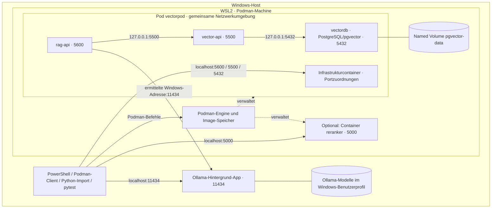

# 7 Verteilungssicht nach arc42 – Römer-RAG

Stand: 15.11.2026. Beschrieben werden die Windows-/WSL-Umgebung, der Neuaufbau gemäß [README](../README.md), die bereits geprüfte alternative Betriebsvariante und die isolierte pytest-Umgebung. Grundlage sind die aktuellen Dockerfiles und [Testfixtures](../tests/podman/conftest.py). Historische `k8s`-Verzeichnisse sind nicht Bestandteil dieser Sicht. Komponenten erklärt die [Bausteinsicht](5-bausteinsicht.md), Aufrufreihenfolge und Ollama-Ermittlung die [Laufzeitsicht](6-laufzeitsicht.md).

## 7.1 Infrastruktur und Verteilung im Neuaufbau

Der Podman-Client läuft auf Windows, die Container-Engine innerhalb der WSL2-Machine. Images, Containerdateisysteme und Named Volumes werden von dieser Linux-Engine verwaltet. Ollama ist ein Windows-Prozess und kein Container in diesem Aufbau.

Ein Pod ist eine Gruppe von Containern mit gemeinsamer Netzwerkumgebung. Deshalb erreichen sich die Dienste in `vectorpod` über `127.0.0.1`, obwohl sie in getrennten Containern laufen. Der Infrastrukturcontainer hält diese Umgebung und die Portzuordnungen. `localhost` aus PowerShell bezeichnet dagegen Windows. Die veröffentlichen Ports erlauben den Zugriff vom Windows-Host auf die Dienste in der Machine.

Der Standardaufbau benötigt keine GPU. Der optionale Reranker läuft separat und ist nicht in den RAG-Aufrufpfad eingebunden. Ein optionaler WSL-GPU-Start reicht `/dev/dxg` und `/usr/lib/wsl/lib` an diesen Container weiter; Voraussetzungen und Startvariante stehen im README. Die Standard-Testfixture reicht keine GPU durch.

## 7.2 Container und Images

| Ausführungseinheit | Image / Quelle | Platzierung und Konfiguration |
|---|---|---|
| `vectordb` | `localhost/vectordb:local`, [Dockerfile](../Vector/Dockerfile), Basis PostgreSQL 17 | In `vectorpod`; pgvector wird beim Image-Build kompiliert. Datenbank `vector_db`, Beispielbenutzer `admin`. |
| `vector-api` | `localhost/vectorapi:local`, [Dockerfile.api](../Vector/Dockerfile.api) | In `vectorpod`; `DB_HOST=127.0.0.1`, `DB_PORT=5432`, weitere Zugangsdaten über Umgebungsvariablen. |
| `rag-api` | `localhost/rag-api:local`, [Dockerfile](../rag/Dockerfile) | Im README-Neuaufbau in `vectorpod`; `VECTOR_API_URL=http://127.0.0.1:5500/search`. Ollama-Adresse automatisch oder über `OLLAMA_BASE_URL`. |
| `reranker`, optional | `localhost/reranker:local`, [Dockerfile](../reranker/Dockerfile) | Separater Container; Standardmodell `cross-encoder/ms-marco-MiniLM-L6-v2` wird beim Build heruntergeladen. |
| Ollama | Installierte Windows-App | Außerhalb von WSL/Containern; persistente Benutzervariable `OLLAMA_HOST=0.0.0.0:11434`. |
| Import und Analyse | Python-Dateien im Repository | Auf Windows; direkte HTTP-Aufrufe zu Ollama und Vector-API. |

Anwendungscode und Python-Abhängigkeiten liegen in den Images. Eine Codeänderung erfordert einen Image-Neubau und die Neuerstellung des betreffenden Containers. Die im README verwendeten Startbefehle konfigurieren keinen automatischen Wiederanlauf der Podman-Container nach einem Host-Neustart; eine laufende Podman-Machine allein startet diese Dienste nicht garantiert. Vorhandene Container können über `podman start` beziehungsweise einen Pod über `podman pod start` wieder gestartet werden; PostgreSQL muss vor der Vector-API bereit sein.

## 7.3 Ports und Netzwerkgrenzen

Die Tabelle beschreibt den Neuaufbau; „Hostport“ ist der vom Windows-Host verwendete Port. Eine `EXPOSE`-Angabe im Dockerfile allein veröffentlicht keinen Port. Dafür sind die `-p`-Optionen beim Erstellen des Pods beziehungsweise separaten Containers erforderlich.

| Dienst | Port des Dienstes | Hostport im Neuaufbau | Nutzung |
|---|---|---|---|
| PostgreSQL | 5432/TCP | 5432, am Pod veröffentlicht | Hostwerkzeuge; Vector-API nutzt intern `127.0.0.1:5432`. |
| Vector-API | 5500/TCP | 5500, am Pod veröffentlicht | Import und Analyse vom Host; RAG im selben Pod nutzt intern Port 5500. |
| RAG-API | 5600/TCP | 5600, am Pod veröffentlicht | `POST http://localhost:5600/process` vom Host. |
| Reranker | 5000/TCP | 5000, am separaten Container veröffentlicht | Optional `/health` und `/rerank`. |
| Windows-Ollama | 11434/TCP | Kein Podman-Mapping | Windows-Aufrufe über `localhost`; Container über erreichbare Windows-Adresse. |

Die README-Portmappings ohne spezielle Bindungsadresse sind nicht auf Windows-Loopback beschränkt. Ebenso nimmt `OLLAMA_HOST=0.0.0.0:11434` Verbindungen auf allen IPv4-Schnittstellen an. Den Zugriff über die Firewall auf die benötigte Umgebung begrenzen.

Für Ollama prüft die RAG-API zunächst `host.containers.internal:11434` und unter WSL zusätzlich die sichtbaren Default-Gateways. Der Windows-Gateway ist im hier geprüften WSL-NAT-Betrieb ein erreichbares Ziel; seine IP wird nicht fest in der Anwendung gespeichert. Bei anderen Netzwerken kann eine explizite `OLLAMA_BASE_URL` nötig sein. Für die Vector-API existiert keine entsprechende automatische Ermittlung. Die [Laufzeitsicht](6-laufzeitsicht.md) erläutert diese Unterschiede und die Fehlerdiagnose.

## 7.4 Persistente Daten und Lebensdauer

| Daten / Artefakte | Speicherort | Verhalten bei Container-Neuerstellung |
|---|---|---|
| PostgreSQL-Daten des README-Aufbaus | Named Volume `pgvector-data`, eingebunden auf `/var/lib/postgresql/data`; `PGDATA=/var/lib/postgresql/data/pgdata` | Bleiben erhalten, solange das Volume erhalten und wieder eingebunden wird. |
| Ollama-Modellgewichte | Windows-Benutzerprofil, üblicherweise `.ollama/models`; eine eigene Ollama-Modellpfadkonfiguration kann abweichen | Unabhängig von RAG-/Datenbankcontainern. |
| Reranker-Standardmodell | Modellcache im gebauten Reranker-Image | Im selben Image erneut verfügbar; der README-Start richtet kein eigenes Modellvolume ein. Zusätzliche Laufzeitdownloads können im Containerdateisystem liegen. |
| RAG- und Vector-API-Code | Images bzw. daraus erzeugte Container | Keine eigenen Datenvolumes im dokumentierten Start; Datenzugriffe gehen an PostgreSQL. |
| Importquelldateien und Importprotokolle | Windows-Dateisystem, gemäß lokalen Skripten | Unabhängig von Podman-Volumes. |

`init.sql` wird nur bei Initialisierung eines leeren PostgreSQL-Datenverzeichnisses ausgeführt. Ein Image-Neubau aktualisiert kein bestehendes Schema und importiert keine Daten. Bei bereits vorhandenen Installationen vor einem Umbau die tatsächlichen Mounts mit `podman inspect vectordb` prüfen; der Name eines vorhandenen Volumes allein beweist nicht, dass der laufende Container es nutzt. Weder ein Pod-Neuaufbau noch ein Containerwechsel erfordert das Löschen von Datenvolumes. Ein Named Volume ersetzt keine Datensicherung.

## 7.5 Alternative: bestehender Datenbank-Pod und separate RAG-API

Im am 15.11.2026 geprüften Betrieb veröffentlicht der ältere `vectorpod` nur 5432 und 5500. Um den bestehenden Pod mit Datenbank und Vector-API zu erhalten, läuft `rag-api` separat mit `-p 5600:5600`. Seine Suchadresse ist der Standard `http://host.containers.internal:5500/search`, der in dieser Umgebung die veröffentlichte Vector-API erreicht.

Diese Variante und der gemeinsame Pod aus Abschnitt 7.1 sind Alternativen. Beim separaten RAG-Container würde `127.0.0.1:5500` nicht die Vector-API im anderen Pod erreichen. Ist die veröffentlichte Adresse in einer anderen Netzwerkkonfiguration nicht erreichbar, muss `VECTOR_API_URL` angepasst werden. Datenbankcontainer und Datenmounts bleiben bei einem Wechsel allein des RAG-Containers erhalten.

## 7.6 Isolierte Testverteilung

Die pytest-Fixture erstellt pro Sitzung einen separaten Pod `rag-test-<id>`, ein Volume `rag-test-data-<id>` und Container mit derselben eindeutigen Kennung. PostgreSQL und Vector-API gehören immer dazu; RAG-API und Reranker werden je nach Testoption ebenfalls in diesen Test-Pod aufgenommen. Der Test-Reranker liegt damit anders als im README-Regelbetrieb im gemeinsamen Pod.

| Ressource | Testkonfiguration |
|---|---|
| PostgreSQL | Intern Port 5432, kein veröffentlichter Hostport; eigenes Testvolume am gleichen Datenpfad wie im regulären Container. |
| Vector-API | Intern 5500, dynamischer Hostport. |
| RAG-API, optional | Intern 5600, dynamischer Hostport; Suche über `127.0.0.1:5500` im Test-Pod. |
| Reranker, optional | Intern 5000, dynamischer Hostport. |
| Ollama | Weiterhin Windows-Hintergrund-App, mit Betrieb geteilt; kein Test-Modellvolume und kein Test-Ollama-Container. |
| Images | Eindeutige Tags `test-<id>`; Buildcache kann gemeinsam verwendet werden. |

Die Fixture liest die zugewiesenen Hostports am Infrastrukturcontainer aus. Deshalb können Teststack und regulärer Stack mit ihren festen Ports parallel laufen. Testdaten werden nur in der Testdatenbank gespeichert. Ollama-Rechenleistung und Modellzustand werden gemeinsam genutzt; Tests können daher die Laufzeiten regulärer Modellanfragen beeinflussen.

Nach dem Lauf werden die eigenen Container, der Pod, das Testvolume und die Test-Image-Tags entfernt. `--keep-podman` erhält diese Ressourcen zur Diagnose. Bestehende Betriebscontainer und Datenvolumes werden nicht zum Testziel umgewidmet. Optionen und fachliche Testgrenzen stehen im [Testkonzept](8-1-testkonzept.md).

## 7.7 Geltungsbereich der Prüfung

Historische Aenderungs- und Pruefnachweise: [Changelog](../changelog.md).
