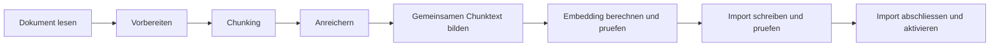

# 8.4 Variantenfaehiges Importkonzept

Stand: 24.11.2026. Der gemeinsame Import ist als `python -m Ingest.pipeline` verfuegbar. Er unterstuetzt rekursives Chunking, keine Anreicherung oder Keywords und denselben Chunktext fuer Embedding und Speicherung. `Ingest/import3.py` bleibt als eigenstaendiger Einstieg erhalten. Die Abschnitte kennzeichnen offene Teile des Zielbilds.

Das Konzept konkretisiert [TS-05, TS-12, TS-14 und TS-17](11-2-technische-schulden.md) und baut auf [Error-Handling, Kapitel 8.3](8-3-error-handling.md), dem [Testkonzept](8-1-testkonzept.md) und der [manuellen Set-Zuordnung](8-2-embedding-sets.md) auf.

## 8.4.1 Ziel und Leitentscheidung

Chunking, Textanreicherung und Embedding sollen unabhaengig untersucht werden koennen, ohne fuer jede Idee einen vollstaendigen Importer zu kopieren. Welche Chunkingverfahren spaeter gebraucht werden, ist heute offen. Deshalb gilt:

**Ein gemeinsamer Importablauf, austauschbare Strategiefunktionen und explizite Versuchskonfigurationen.**

Bekannte Varianten desselben Algorithmus werden durch Parameter ausgedrueckt. Ein anderer Algorithmus bekommt ein eigenes Python-Modul. Neue Ideen muessen nicht in eine immer groessere Fallunterscheidung oder einen universellen Parametersatz passen. Speicherung, Identitaeten, Fehlerberichte und Wiederaufnahme bleiben Verantwortung des gemeinsamen Ablaufs.

Zunaechst genuegen Funktionen und eine explizite Registry. Automatische Pluginsuche, dynamisch importierte Module aus Konfigurationsdateien und eine Klassenhierarchie sind nicht erforderlich. Import darf weiterhin direkt Ollama und Vector-API verwenden; die RAG-API ist kein notwendiger Import-Proxy.

## 8.4.2 Verarbeitungsschritte



| Schritt | Eingabe und Ausgabe | Verantwortung |
|---|---|---|
| Lesen | Datei zu Dokument mit Quellkennung, Version und Text | Gemeinsamer Ablauf; UTF-8, nachvollziehbare Quelle |
| Vorbereiten | Dokument zu vorbereitetem Dokument | Strategie, anfangs unveraendert; Original bleibt erhalten |
| Chunking | Dokument und Strategieparameter zu geordneten Chunks | Nur Textzerlegung; keine HTTP- oder DB-Aufrufe |
| Anreichern | Chunks zu Chunks mit separater Anreicherung | Beispielsweise keine Anreicherung, Keywords oder spaeter Zusammenfassungen |
| Textbildung | Quelltext und optionale Anreicherung zu einem gemeinsamen chunktext | Ohne Anreicherung Originalchunk; sonst Anreicherung, Zeilenumbruch und Originalchunk |
| Embedding | Gemeinsamer chunktext zu geprueftem Vektor | Modellaufruf, Normalisierung, Dimension und endliche Werte |
| Schreiben/Abschluss | Vollstaendiges Ergebnis zu freigegebenem Import | Identitaet, Fehlerbericht, Vollstaendigkeit, Altlasten und Aktivierung |

Chunking und Anreicherung sind mit `Ingest.chunk` und `Ingest.enrich` einzeln ausfuehrbar. Die Pipeline kann mit vorhandenen Chunk- oder Anreicherungsartefakten beginnen. Ein anderer Embeddingversuch muss vorhandenes Chunking oder eine teure Keywordgenerierung nicht erneut ausfuehren. Lokale Artefakte bilden die Uebergaben; die Aufteilung entspricht dem Gedanken hinter den RAG-Endpunkten `/evaluate/retrieve`, `/evaluate/rerank` und `/evaluate/generate`.

## 8.4.3 Strategieimplementierung und Aufruf

`Ingest/pipeline.py` waehlt die Strategiefunktionen ueber explizite Registries. `Ingest/utils/chunking.py` enthaelt die gemeinsame rekursive Textzerlegung, `Ingest/utils/keywords.py` den fuer beide Importer verwendeten Keyword-Prompt. Die Pipeline verwendet Absatz- und Satztrennzeichen in der bisherigen Reihenfolge und ergaenzt einen Zeichen-Fallback fuer lange ungetrennte Passagen. Die Standardwerte sind 1000 Zeichen und 150 Zeichen Ueberlappung. Die Versuchskonfiguration liegt unter `Ingest/experiments`.

Versuche koennen `chunking.parameters.separators` als geordnete Liste literaler Trennzeichen ueberschreiben. Ein optionales leeres Trennzeichen steht ausschliesslich am Ende und aktiviert bei Bedarf den Zeichen-Fallback. Ohne dieses Element koennen Chunks die konfigurierte Groesse ueberschreiten. `Ingest/experiments/snowflake-arctic-embed-v1.json` verwendet die LangChain-Standardtrennzeichen `["\n\n", "\n", " ", ""]`, 1000 Zeichen und 100 Zeichen Overlap. `Ingest/experiments/snowflake-arctic-embed-v2.json` verwendet die Absatz- und Satztrennzeichen ohne Zeichen-Fallback, 1000 Zeichen, 150 Zeichen Overlap, den gemeinsamen Keyword-Prompt mit `gemma3:4b` und normalisierte Embeddings mit `snowflake-arctic-embed2`. Die Konfiguration bildet den Verarbeitungspfad bei erfolgreichen Providerantworten ab. Die Pipeline verwendet ihr eigenes Embedding-Set und bricht beim ersten Fehler ab. Artefakte des bisherigen Formats 1 ohne Trennzeichenliste werden mit der bisherigen Pipeline-Reihenfolge gelesen.

Unbekannte Strategien und Parameter werden vor externen Aufrufen zurueckgewiesen. Die Strategie prueft ihre eigenen Parameter. Falls eine spaetere Idee Seiten, Ueberschriften oder Quellpositionen benoetigt, wird die Schnittstelle gezielt auf strukturierte Dokumente/Chunks erweitert. Es werden keine unzuverlaessigen Positionen durch blosse Textsuche erfunden. Deterministische Chunker erhalten fuer dieselbe Eingabe dieselbe Reihenfolge; modellbasierte Chunker dokumentieren ihre Modell-/Zufallsparameter und speichern ihr Ergebnis.

## 8.4.4 Versuchskonfiguration

Algorithmus und Versuch sind getrennt. JSON wird zunaechst bevorzugt, weil es keine neue Parserabhaengigkeit benoetigt. YAML kann spaeter als gleichwertiges Eingabeformat hinzukommen.

```json
{
  "format_version": 1,
  "name": "recursive-keywords-1000",
  "embedding_set_id": "recursive-keywords-1000-v1",
  "chunking": {
    "strategy": "recursive",
    "parameters": {"size": 1000, "overlap": 150}
  },
  "enrichment": {
    "strategy": "keywords",
    "parameters": {"model": "gemma3:4b", "prompt": "keywords-v1"}
  },
  "embedding": {
    "model": "snowflake-arctic-embed2",
    "normalize": true,
    "dimensions": 1024
  }
}
```

Das Beispiel beschreibt die Keyword-Variante mit einem gemeinsamen Text: Keywords, Zeilenumbruch und Originalchunk werden zusammen eingebettet und als chunktext gespeichert. Derselbe Text wird spaeter fuer Reranking und Antwortgenerierung verwendet. Ohne Anreicherung wird der Originalchunk verwendet. Ein texts-Abschnitt oder eine getrennte Auswahl fuer Suche und Kontext ist nicht vorgesehen. Das entspricht dem Prinzip von import3.py; die Pipeline erhaelt Trennzeichenreihenfolge und Prompt und aktiviert standardmaessig den Zeichen-Fallback. Die beispielhafte Set-ID ist keine Herkunftsaussage ueber bestehende Sets.

Die vollstaendig aufgeloesten Einstellungen eines Laufs werden im lokalen Laufbericht festgehalten. Bei gleicher Versuchskonfiguration sollen geaenderte Defaults nicht unbemerkt das Ergebnis aendern. Die Konfiguration enthaelt keine Zugangsdaten. Modellrevisionen, Code-/Buildstand und Promptinhalt oder dessen eindeutige Version gehoeren, soweit bekannt, in den Nachweis; ein Modellname allein belegt keine unveraenderlichen Gewichte.

**Abgrenzung zu R-01:** Konfigurationsdateien steuern den lokalen Versuch und validieren Parameter syntaktisch. Sie ersetzen nicht die manuelle Zuordnung zur Set-ID und pruefen keine Konfiguration gegen eine Datenbankregistrierung. Set-IDs werden nicht automatisch berechnet. Die Zuordnung wird weiterhin manuell in Kapitel 8.2 gepflegt; bei geaenderter Verarbeitung wird eine neue Set-ID gewaehlt. Eine automatische Set-Konfigurationspersistenz oder -pruefung benoetigt eine gesonderte Entscheidung zu R-01.

## 8.4.5 Daten und Zwischenergebnisse

Originaltext und Anreicherung bleiben fuer Nachvollziehbarkeit und Wiederverwendung getrennt im lokalen Artefakt erhalten. Fuer die weitere Verarbeitung gibt es jedoch nur einen gemeinsamen Text:

| Inhalt | Bedeutung |
|---|---|
| source_text | Unveraenderter Text des Chunks nach dokumentierter Vorbereitung |
| enrichment | Getrennte Keywords, Zusammenfassung oder andere Anreicherung; bei keiner Anreicherung leer |
| chunktext | Gemeinsamer Text fuer Embedding, Reranking und Antwortgenerierung |
| vector | Vektor des chunktext, mit Modell, Dimension und Normalisierungsangabe |

Mit Keywords lautet chunktext: Keywords + Zeilenumbruch + source_text. Ohne Anreicherung ist chunktext identisch zu source_text. Der tatsaechlich eingebettete Text wird unveraendert in der vorhandenen Spalte chunktext gespeichert und von dort an Reranker und Antwortmodell gegeben. Dafuer werden weder embedding_text/context_text-Felder noch eine neue Textauswahl oder Schemaerweiterung benoetigt. Die spaetere Trennungsmoeglichkeit ist ausschliesslich in Abschnitt 8.4.10 beschrieben und gehoert nicht zum aktuellen Umsetzungsumfang.

Die Pipeline schreibt versionierte Artefakte `chunks.json`, `enriched.json` und `embeddings.json` fuer die ausgefuehrten Stufen. Sie enthalten Quellpfad, SHA-256 der Quelldatei, Stufe, Strategieparameter und geordnete Ergebnisse. `run.json` dokumentiert Lauf-ID, Eingabe, aufgeloeste Konfiguration, erzeugte Artefakte, Stufenzeiten und Speicherausgang. Enriched-Artefakte speichern pro Chunk die Anfragezeit und verfuegbare Ollama-Zeit- und Tokenmetriken. Ein separates Dokumentartefakt bleibt offen.

Ein Chunkingartefakt koennte gekuerzt so aussehen:

```json
{
  "format_version": 1,
  "stage": "chunks",
  "document_id": "pg3060",
  "source": "<absoluter Quellpfad>",
  "source_version": "<Inhaltsdigest der Quelldatei>",
  "chunking": {
    "strategy": "recursive",
    "parameters": {"size": 1000, "overlap": 150}
  },
  "chunks": [
    {"chunk_id": "pg3060-1", "source_text": "Erster Textabschnitt ..."},
    {"chunk_id": "pg3060-2", "source_text": "Zweiter Textabschnitt ..."}
  ]
}
```

Wiederverwendung ist explizit: Der Anwender waehlt ein gespeichertes Eingabeartefakt. Kein automatischer globaler Cache ist erforderlich. Der Ablauf prueft Dateiformat und benoetigte Felder; die Verwendung einer vorhandenen Anreicherung behauptet nicht, das Modell erneut ausgefuehrt zu haben. Neue Laufzeiten werden von gespeicherten Herkunftsmetriken getrennt. Artefakte werden erst nach vollstaendigem Schreiben als verwendbar markiert; abgebrochene Dateien sind keine erfolgreichen Zwischenergebnisse.

## 8.4.6 CLI

Die folgenden Befehle werden aus dem Projektstamm ausgefuehrt. Jeder Pipeline-Aufruf erfordert ein neues Ausgabeverzeichnis.

```powershell
# Nur Chunking
python -m Ingest.chunk --file Ingest/pg3060.txt `
  --config Ingest/experiments/test-recursive-1000.json `
  --output artifacts/test-recursive-1000/chunks.json

# Vollstaendiger Import mit derselben Versuchskonfiguration
python -m Ingest.pipeline --file Ingest/pg3060.txt `
  --config Ingest/experiments/test-recursive-1000.json `
  --output-dir artifacts/test-recursive-1000/run-001

# Ab vorhandenen Chunks: Anreicherung, Embedding und Schreiben
python -m Ingest.pipeline --from chunks `
  --input artifacts/test-recursive-1000/chunks.json `
  --config Ingest/experiments/test-recursive-1000.json `
  --output-dir artifacts/test-recursive-1000/run-002
```

Der reine Anreicherungsaufruf `python -m Ingest.enrich --input <chunks.json> --config <Versuch.json> --output <enriched.json>` endet nach dem Schreiben des Artefakts. Modell, eingebaute Promptversion oder ein eigener versionierter Systemprompt werden in `enrichment.parameters` gewaehlt. Beispiele stehen in der [Importanleitung](../Ingest/README.md).

Der reine Chunkingaufruf benoetigt nur den chunking-Abschnitt der Konfiguration und keinen Datenbank- oder Modellzugriff. Mit `--from enriched --input <Pfad zu enriched.json>` beginnt der Ablauf beim Embedding. Die Chunkingparameter und bei Anreicherungsartefakten auch die Anreicherungsparameter muessen uebereinstimmen. Fuer ein anderes Embedding werden das Modell und die manuell zugeordnete Set-ID angepasst. Die Wiederverwendung von Embeddingartefakten zum isolierten Schreiben und weitere einzeln ausfuehrbare Stufen bleiben Teil des Zielbilds.

## 8.4.7 Identitaet, Wiederholung und Abschluss

Die Dokumentidentitaet wird durch den Dateinamen ohne die letzte Erweiterung bestimmt, in Python durch `Path(file_path).stem`. Der Dateistamm muss innerhalb eines embedding_set_id eindeutig sein, auch ueber verschiedene Quellverzeichnisse hinweg. Die Chunk-ID lautet `<Dateistamm>-<Chunknummer>`; die Nummerierung beginnt bei 1. Beispiel: rom.band1.txt ergibt rom.band1-1, rom.band2.txt ergibt rom.band2-1. Eine Datei ohne Erweiterung behaelt ihren Namen; bei rom.tar.gz wird nur .gz entfernt.

Chunker liefern Reihenfolge und Text. Der gemeinsame Ablauf vergibt daraus die IDs; Verzeichnis, Dateierweiterung, Inhaltsversion und Lauf-ID sind keine Bestandteile der Chunk-ID. Quellversion (beispielsweise Inhaltsdigest) und Lauf-ID bleiben getrennte Angaben fuer Artefakte, Wiederaufnahme und Importabschluss. Sie ersetzen den vereinbarten Dateistamm nicht. Unveraenderte Wiederholungen verwenden dieselben Schluessel.

Gleiche Staemme wie rom.txt und rom.md fuehren innerhalb desselben Sets zu denselben Chunk-IDs. Dasselbe gilt fuer gleichnamige Dateien aus verschiedenen Verzeichnissen. Diese Faelle werden durch manuelle Namenswahl oder getrennte Sets vermieden; eine zusaetzliche technische Kollisionsabsicherung ist derzeit nicht vorgesehen. Das bewusst akzeptierte Restrisiko ist in [R-02](11-1-risiken.md#r-02-dateistamm-als-dokumentidentitaet) festgehalten.

Die Dateistammregel ist seit 22.11.2026 in import3.py mit Path.stem umgesetzt und fuer mehrteilige Namen sowie Namen ohne Erweiterung getestet. Die Pipeline verwendet dieselbe Dateistammregel. Fuer mehrteilige Namen aendern sich gegenueber der alten Erste-Punkt-Logik die Schluessel; alte Eintraege werden nicht automatisch migriert oder entfernt. Vor einem Wiederholungsimport bestehender Quellen muss deren Altbestand explizit geprueft und eine Bereinigung geplant werden; vorhandene Daten wurden durch diese Codekorrektur nicht veraendert.

Ein fachlich vollstaendiger Import umfasst auch den Umgang mit alten Chunks: Ein kuerzerer Neuimport darf keine ueberzaehligen alten Treffer aktiv lassen. Neue und alte Versionen duerfen waehrend eines fehlgeschlagenen Imports nicht unbemerkt als vollstaendiger Stand vermischt werden. Ziel ist eine vorbereitete Version, deren Vollstaendigkeit geprueft und erst danach freigegeben wird; bei Fehlern bleibt die vorherige vollstaendige Version nutzbar.

Die technische Umsetzung dieser Freigabe bleibt Teil von TS-05: Dokument-/Versionszuordnung, Transaktionsgrenze beziehungsweise Staging und aktive Sicht muessen vor Implementierung festgelegt werden. Das heutige Schema und Einzel-Upserts leisten keine dokumentweite Aktivierung oder Bereinigung. Die vereinbarten stabilen Chunk-IDs allein reichen fuer diesen Abschluss nicht aus; Freigabe und Altlastenbereinigung muessen gesondert umgesetzt werden. Bestehende Daten erhalten einen expliziten Migrations-/Neuimportpfad mit Backup; manuell genutzte Volumes werden nicht geloescht. Dafuer werden vorhandene Migrationen erweitert, nicht neu erfunden.

## 8.4.8 Fehler, Wiederaufnahme und Metriken

Die Pipeline bricht beim ersten Fehler ab und schreibt nach dem Anlegen des Laufverzeichnisses einen Bericht mit Fehlerphase, Chunk-ID, Fehlerklasse und bestaetigten Schreibvorgaengen. Erfolgreich abgeschlossene lokale Stufen koennen explizit wiederverwendet werden. Exitcodes sind 0 fuer Erfolg, 1 fuer Abbruch und 2 fuer ungueltige CLI-Argumente, Konfiguration oder Eingabeartefakte. Wiederaufnahme ueber einen Laufbericht und Fortsetzen nach isolierten Chunkfehlern sind offen. Dafuer gelten als Ziel die Regeln aus Kapitel 8.3: standardmaessig Abbruch beim ersten Fehler; optionales Fortsetzen nur bei isolierten Chunkfehlern, Abbruch bei systemischen Stoerungen. Ein teilweise erfolgreicher Lauf wird nicht als vollstaendig aktiviert.

Der Laufbericht nennt erwartete, erfolgreiche und fehlgeschlagene Dokumente/Chunks, Fehlerphase, Ursache in sicherer Form und verwendete Artefakte. Exitcodes: 0 vollstaendiger Erfolg, 1 Abbruch, 2 ungueltiger Aufruf, 3 abgeschlossener Lauf mit Teilfehlern. Wiederaufnahme waehlt einen vorhandenen Laufbericht und dessen unveraenderte Eingaben; geaenderte Quelle oder Strategie startet einen neuen Versuch. Ein blosser --start-Index ist kein ausreichender Resume-Vertrag.

Externe Adapter pruefen Antwortvertraege und besitzen explizite Zeitlimits. Generierung und Datenbankwrites werden nicht allein wegen eines Timeouts automatisch wiederholt. Sichere Wiederaufnahme verwendet stabile Identitaeten und bekannte erfolgreiche Zwischenergebnisse. Rohtexte, Prompts oder Providerantworten gehoeren nicht standardmaessig in Fehlerlogs; bewusst gespeicherte Inhaltsartefakte werden getrennt behandelt.

Laufzeiten werden pro Stufe und fuer den gesamten Import mit monotoner Uhr in Sekunden gemessen. Vorhandene Provider-Ladezeiten und Tokenzahlen bleiben von der gemessenen Stufenwartezeit getrennt. Anzahl und Groessen der Chunks, Overlapparameter und Umfang der Anreicherung sind Versuchsdaten. Diese Betriebsmetriken ersetzen keine Qualitaetsbewertung mit Gold-Antworten.

## 8.4.9 Einfuehrung und Abnahme

Die Einfuehrung erfolgt schrittweise:

1. Bestehendes import3-Verhalten als Baseline festhalten: Chunkgrenzen, Overlap, Keywords, Textbildung, Normalisierung und Set-Zuordnung. Fehler aus TS-05 nicht als gewuenschtes Verhalten konservieren.
2. Gemeinsamen Ablauf mit Strategien recursive sowie enrichment none/keywords einfuehren. Parameterunterschiede explizit machen; Altimporter nach gepruefter Ablosung archivieren oder eindeutig kennzeichnen.
3. Versionierte Artefakte und einzeln aufrufbare Stufen ergaenzen; getrennte Versuche ohne erneute vorgelagerte Modellaufrufe pruefen.
4. Importidentitaet, Freigabe, Altlastenbereinigung, Fehlerabschluss und Resume gemaess TS-05 mit Migrationsplan implementieren.
5. Neue Chunkingideen erst bei einem konkreten Versuch als weitere Funktionen/Module ergaenzen. Keine spekulative Implementierung aller denkbaren Strategien.

Abnahme gemaess Kapitel 8.1: deterministische Tests fuer Parameter, Grenzen, Overlap, Reihenfolge, Identitaet und Artefaktruecklesen; Vertragstests fuer Textbildung und das Ueberspringen bereits ausgefuehrter Stufen; isolierte Integration fuer Keyword-/Embeddingprovider und Speicherung. Namenskollisionen, verkuerzte Neuimporte, Fehler vor Freigabe und Resume benoetigen eigene Tests. Bei Qualitaetsvergleichen werden moeglichst einzelne Faktoren geaendert; ein anderer Chunker mit gleichzeitig anderer Anreicherung ist kein isolierter Chunkingvergleich.

Die Einfuehrung des gemeinsamen Ablaufs und die Wiederverwendung von Chunk- und Anreicherungsartefakten sind umgesetzt. Dokumentweiter Importabschluss, Bestandsmigration und Gold-Evaluation bleiben eigene Arbeitspakete.

## 8.4.10 Moegliche spaetere Erweiterung: Embeddingtext und Kontext trennen

**Zurueckgestellt: Diese Trennung soll zurzeit nicht umgesetzt werden.** Sie ist keine Anforderung an den ersten Importerumbau. Es werden dafuer weder Konfigurationsschalter noch separate Felder, APIs oder Datenbankmigrationen vorbereitet. Aktuell gilt ausschliesslich der gemeinsame chunktext aus Abschnitt 8.4.5.

Die Idee bleibt fuer spaetere Qualitaetsversuche relevant: embedding_text waere der Text, aus dem der gespeicherte Vektor berechnet wird. Er beeinflusst, welche Chunks die Vektorsuche findet. context_text waere der Text fuer Reranker und Antwortmodell; er beeinflusst die Neusortierung und die erzeugte Antwort. Beide Texte koennen identisch sein, muessen es bei einer spaeteren Erweiterung aber nicht sein.

Beispiel:

```text
Original:
Die vereinigte Macht der Italiker und Phoeniker behauptete
 die westliche Haelfte des Mittelmeeres.

Generierte Keywords:
Italiker, Phoeniker, westliches Mittelmeer
```

| Versuchsvariante | Text fuer Embedding | Text fuer Reranking und Antwort |
|---|---|---|
| Aktuelles Konzept und bisheriges import3-Prinzip | Keywords + Original | Keywords + Original |
| Nur moeglicher spaeterer Versuch | Keywords + Original | Original |

Die zweite Variante koennte untersuchen: Verbessern Keywords das Retrieval, ohne sie anschliessend als zusaetzlichen Inhalt an das Antwortmodell zu geben? Generierte Anreicherungen koennen unpassende Begriffe enthalten; mit dieser Trennung liesse sich die Suchwirkung von ihrem Einfluss auf die Antwort unterscheiden. Ob das die Qualitaet verbessert, waere zu messen, nicht vorab anzunehmen. Da context_text auch dem Reranker dient, wuerde seine Aenderung ebenfalls das Reranking beeinflussen; fuer einen isolierten Vergleich muss dieser Faktor konstant gehalten oder gesondert untersucht werden.

Der zuvor vorgeschlagene texts-Abschnitt haette nur ausgewaehlt, welche vorhandenen Bestandteile fuer Embedding und Kontext zusammengesetzt werden. Er haette selbst weder Keywords erzeugt noch Text zerlegt. Diese Aufgabe wird jetzt bewusst nicht konfigurierbar gemacht. Erst bei einem konkreten Versuch waeren getrennte Textauswahl, Artefakt-/Speichervertrag, API-Ausgabe und Migration gemeinsam zu entwerfen und freizugeben.
